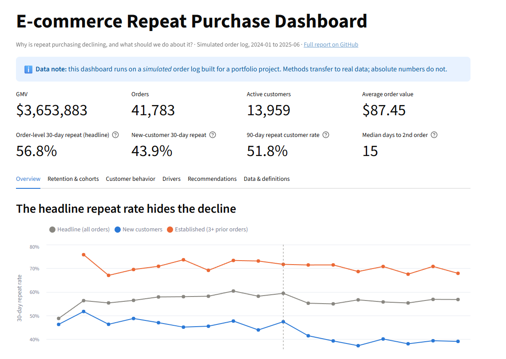
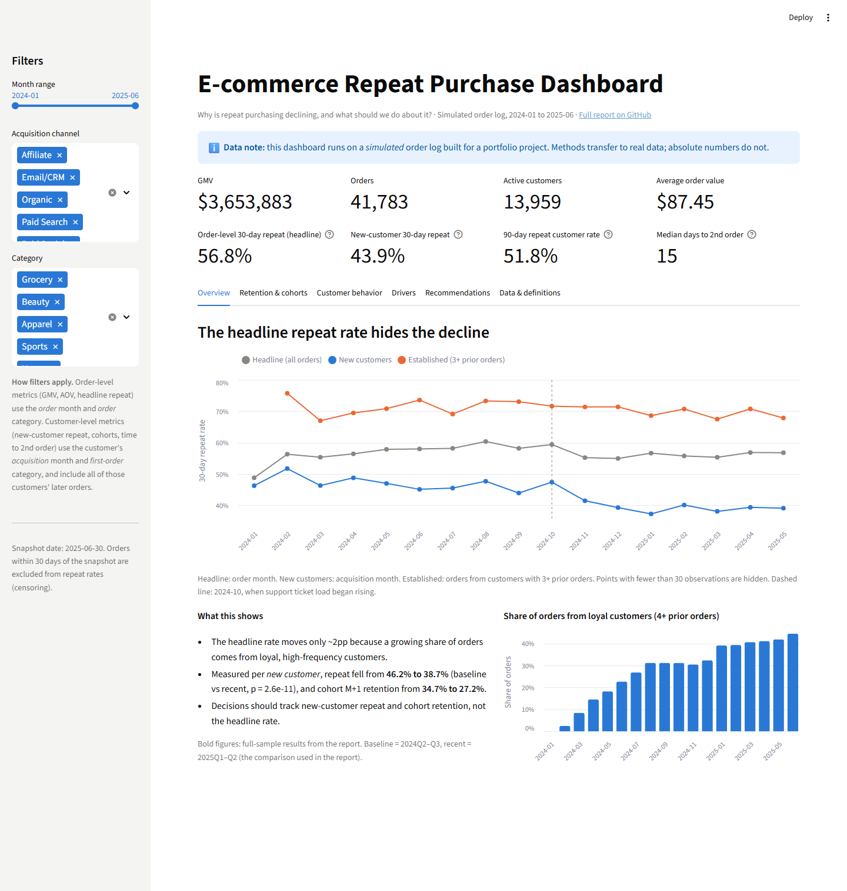
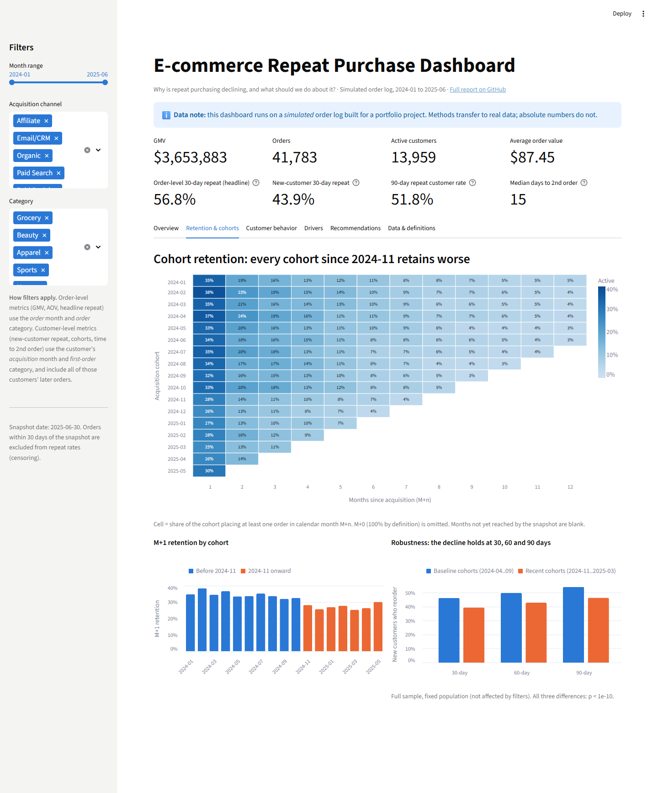
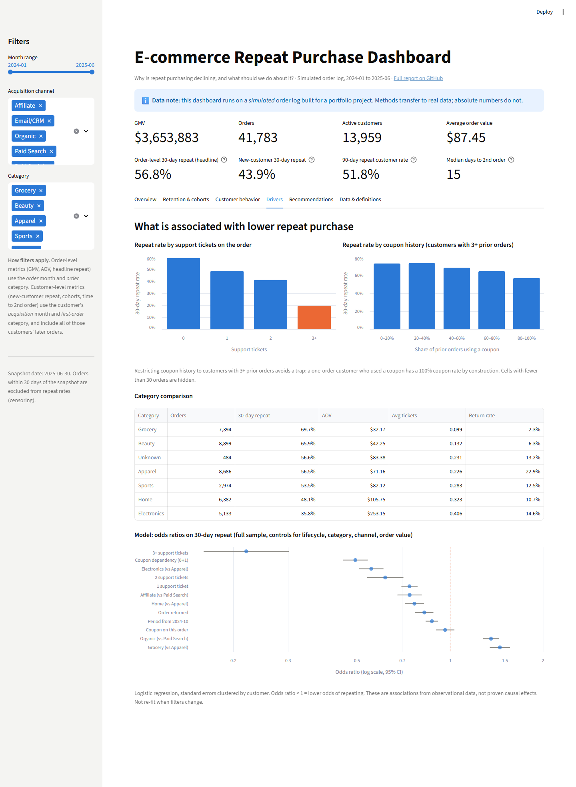
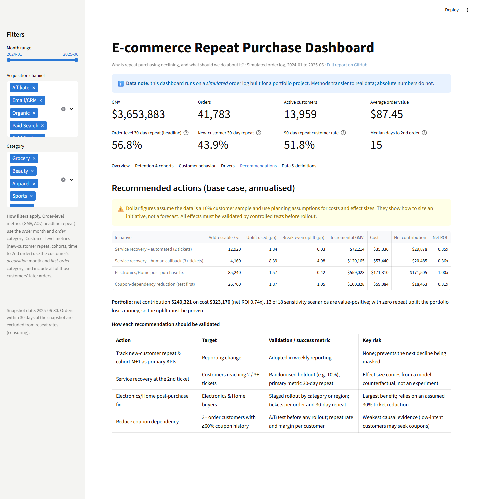

# E-commerce Repeat Purchase Analysis

**Why did new customers stop coming back, and what should the business do about it?**

An end-to-end analytics project on an e-commerce order log (Jan 2024 – Jun 2025). It goes from raw, messy order data to a diagnosis, a driver model, a costed action plan, an interactive dashboard and an executive presentation.

**Tools:** Python (pandas, statsmodels, scikit-learn) · SQL (SQLite window functions) · Streamlit + Altair · PowerPoint

> **Data note:** the order log is **simulated** (`src/00_make_dataset.py`) because no production data was available. Realistic data-quality problems are injected, and the analysis never reads the simulator's settings; it rediscovers the patterns from the data. The project demonstrates analytical method. Its numbers are not real-world facts.



## Key findings

| | Baseline (2024 Q2–Q3) | Recent (2025 Q1–Q2) | Change |
|---|---|---|---|
| Headline 30-day repeat rate (what was reported) | 58.2% | 56.3% | -2.0pp |
| **New-customer 30-day repeat rate** | **46.2%** | **38.7%** | **-7.5pp** (p = 2.6e-11) |
| **Cohort M+1 retention** | **34.7%** | **27.2%** | **-7.6pp** |

1. **The reported KPI hid the decline.** Loyal customers grew from 0% to 42% of orders, so the order-weighted average stayed flat while each new cohort came back less often. The decline holds at 30-, 60- and 90-day windows.
2. **Support tickets are the clearest driver.** Repeat drops from 59% (no ticket) to 20% (3+ tickets); odds ratio 0.22 after controls. The share of orders with a ticket rose from 14% to 27%, concentrated in **Electronics and Home**, the highest-value categories.
3. **Coupon *dependency*, not coupons, hurts repeat.** A coupon on a single order has no significant effect (OR 0.96, p = 0.28). Customers who habitually buy on coupon repeat ~15pp less.
4. **About half of the decline is explained** by tickets, returns and coupon dependency. The rest needs data the order log does not have (delivery times, stockouts).

## Recommendations

| # | Action | Evidence | How to validate | Base-case net / yr* |
|---|---|---|---|---|
| 1 | Report **new-customer repeat and cohort M+1** as primary KPIs | Headline masked a 7.5pp decline | Adopted in weekly review | No cost |
| 2 | Fix **Electronics & Home** post-purchase experience | Lowest repeat, highest AOV, tickets up 2.9x / 1.7x | Staged rollout; tickets/order, 30-day repeat | $171k |
| 3 | **Service recovery** at the 2nd ticket | Repeat cliff at the 3rd ticket | 10% holdout (2 tickets); 50/50 test (3+) | $50k |
| 4 | **Test** reducing coupon dependency | Weakest causal evidence | A/B test before rollout | $18k if proven |

\*Planning estimates: model-based effect sizes, assumed costs and a 10% sample assumption. With zero repeat uplift the portfolio loses money, so each lever must be tested first. Details: [REPORT.md §5](REPORT.md#5-phase-4-financial--roi-impact).

## Deliverables

| Deliverable | Link |
|---|---|
| Full analytical report | [`REPORT.md`](REPORT.md) |
| Executive presentation (15 slides) | [`presentation/Repeat_Purchase_Analysis.pdf`](presentation/Repeat_Purchase_Analysis.pdf) · [editable .pptx](presentation/Repeat_Purchase_Analysis.pptx) |
| Interactive dashboard | [`dashboard/app.py`](dashboard/app.py) (run locally, see below) · [screenshots](#dashboard) |
| KPI definitions | [`docs/kpi_definitions.md`](docs/kpi_definitions.md) |
| Data dictionary | [`docs/data_dictionary.md`](docs/data_dictionary.md) |
| SQL queries | [`sql/kpi_queries.sql`](sql/kpi_queries.sql) |
| Project self-assessment | [`docs/portfolio_review.md`](docs/portfolio_review.md) |

---

## Business problem

Repeat customers are 54% of customers but generate **80% of GMV**. Their value comes from ordering again (4.7 orders on average), not from bigger baskets. The business reported a stable 30-day repeat rate and saw no problem. This project asks:

1. Is repeat purchase really declining, or is it noise?
2. Which customers are affected: new or established?
3. What is associated with the decline: service quality, category, coupons or channel?
4. Which actions are worth funding, and how should they be validated?

**Audience:** e-commerce and CRM leadership (presentation); analysts (report and code).

## Dataset

| | |
|---|---|
| Source | Simulated by `src/00_make_dataset.py` (seeded, deterministic) |
| Size | 42,776 raw rows → 41,783 clean orders, 13,959 customers |
| Fields | order id, customer id, timestamp, amount, category, coupon flag, support tickets, return flag, acquisition channel |
| Injected issues | duplicates, mixed date formats, future dates, QA accounts, sign errors, nulls, sentinel values, mixed boolean encodings, category spelling drift, outliers |

Full schema: [`docs/data_dictionary.md`](docs/data_dictionary.md).

## Method

| Phase | Script | What it does |
|---|---|---|
| 0 | `00_make_dataset.py` | Generates the raw order log |
| 1 | `01_clean_features.py` | Cleans data (every removed row counted), right-censors the last 30 days, builds customer and RFM features |
| 2 | `02_eda_cohort.py` | Three repeat metrics, cohort retention, segment profiles, tipping points (tickets, coupons) |
| 3 | `03_modeling.py` | Logistic regression with **user-clustered SEs**; gradient boosting on a **forward-in-time holdout** (AUC 0.72); mediation ladder |
| 4 | `04_roi.py` | Business cases sized on actual counts, each tested against a **break-even gate**; sensitivity grid |
| 5 | `05_kpis_robustness.py` | KPI table with numerators/denominators; first-time vs repeat customers; robustness checks (30/60/90-day windows, imputed data, clustered tests) |
| 6 | `06_sql_checks.py` | Re-computes core KPIs in SQL from raw columns; **9/9 checks match** pandas |

Three analytical traps were hit and corrected along the way, and each is documented in the report: **survivorship bias** in a cohort trend test, a **confounder treated as a mediator**, and **mechanical confounding** in coupon-dependency bands.

## KPI definitions (summary)

| KPI | Unit | Numerator ÷ denominator |
|---|---|---|
| Order-level 30-day repeat | Order | orders followed by another order ≤ 30 days ÷ orders ≥ 30 days before snapshot |
| New-customer 30-day repeat | Customer | first-time customers reordering ≤ 30 days ÷ first-time customers ≥ 30 days before snapshot |
| Cohort M+1 retention | Customer × month | cohort customers ordering in the next calendar month ÷ cohort size |
| AOV | Order | GMV ÷ orders |

Repeat rate, retention rate and cohort retention are not interchangeable; see [`docs/kpi_definitions.md`](docs/kpi_definitions.md).

## Dashboard

A Streamlit dashboard with KPI tiles, filters (month range, acquisition channel, category) and six tabs. It uses the same KPI code as the analysis (`src/kpis.py`), and an automated test checks that its numbers match the analysis tables. Live demo: [ecommerce-repeat-purchase-analysis.streamlit.app](https://ecommerce-repeat-purchase-analysis-4msj8yiubhkqhq7grmvqzk.streamlit.app/) (Streamlit Community Cloud, Python 3.12; the first visit after a period of inactivity takes ~1 minute while the app wakes up and generates its data).

| Overview | Cohorts |
|---|---|
|  |  |
| **Drivers** | **Recommendations** |
|  |  |

More: [customer behaviour](docs/images/dashboard_03_customer_behavior.png) · [definitions](docs/images/dashboard_06_data_definitions.png).

## How to run

Requires Python 3.10+ (built and verified on 3.10.10).

```bash
git clone https://github.com/Newnew-niu/ecommerce-repeat-purchase-analysis.git
cd ecommerce-repeat-purchase-analysis
pip install -r requirements.txt

python src/run_all.py            # generates data/ and reruns all 7 phases (~1-2 min)
streamlit run dashboard/app.py   # opens the dashboard at http://localhost:8501
python tests/test_dashboard.py   # dashboard smoke tests (or: pytest tests/)
```

`data/` is not stored in git: it is rebuilt deterministically by the seeded generator, so `run_all.py` (or at least `00` and `01`) must run first. The dashboard offers to build the data if it is missing. To confirm your run matches the report, `outputs/tables/04_business_cases.csv` should give a base-case net contribution of **240,321** and net ROI of **0.7436**.

**Rebuilding the presentation** (optional; needs Node.js, and PowerPoint for the PDF):

```bash
cd presentation/build && npm install && npm run build                  # writes the .pptx from outputs/tables
powershell -ExecutionPolicy Bypass -File presentation/build/export_pdf.ps1   # .pptx -> .pdf (Windows + PowerPoint)
```

## Repository structure

```
├── README.md
├── REPORT.md                  full analytical report
├── requirements.txt
├── src/                       pipeline: 00–06, kpis.py (KPI definitions), run_all.py
├── sql/kpi_queries.sql        SQL version of the core KPIs
├── dashboard/app.py           Streamlit dashboard
├── tests/test_dashboard.py    dashboard smoke tests
├── presentation/              executive deck (.pptx, .pdf) + build/ (generator script)
├── docs/                      KPI definitions, data dictionary, portfolio review, screenshots
├── outputs/figures/           report charts
├── outputs/tables/            every reported number, as CSV
├── logs/                      full output of each phase
└── data/                      generated locally (git-ignored)
```

## Limitations

- **Simulated data:** methods transfer; numbers and effect sizes do not.
- **Observational:** no experiments were run; the ticket and coupon effects are associations that survive controls, not proven causes.
- **About half of the decline is unexplained** by the available fields.
- **Dollar figures** depend on a 10% sample assumption and planning costs.
- **Timing:** support tickets and returns are realised after purchase and may overlap the 30-day outcome window.

## Possible next steps

- Apply the pipeline to a real public dataset (e.g. the Olist Brazilian e-commerce dataset) to test the method on genuinely unknown patterns.
- Add timestamped support/return events to remove outcome-window overlap.
- Deploy the dashboard (e.g. Streamlit Community Cloud) and add a customer-level churn-risk score.

## License

MIT, see [LICENSE](LICENSE).
