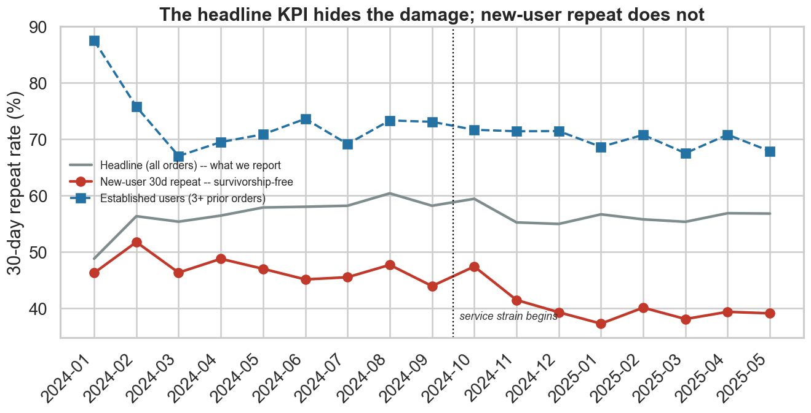
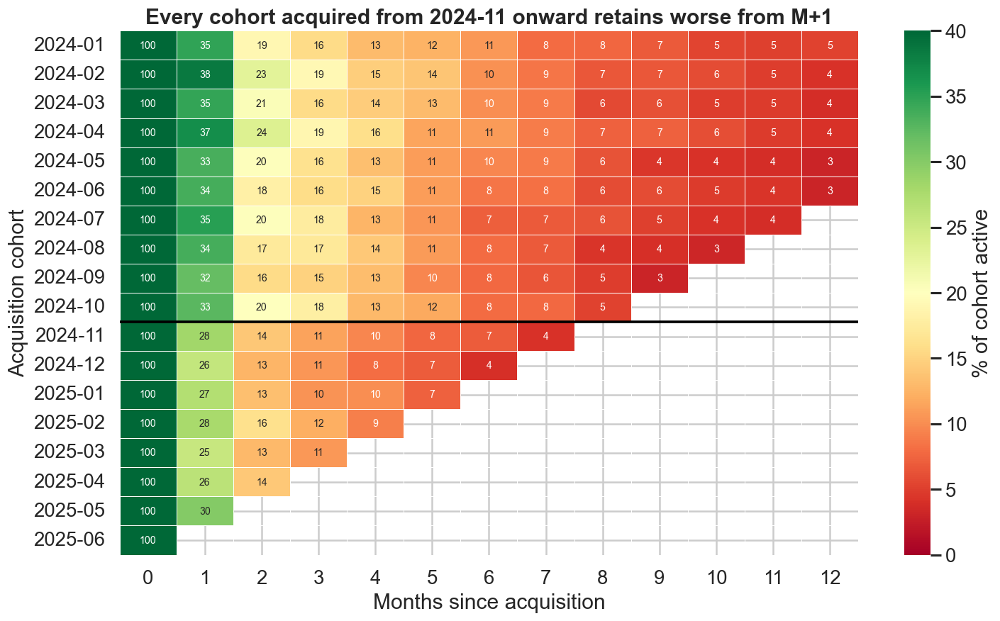
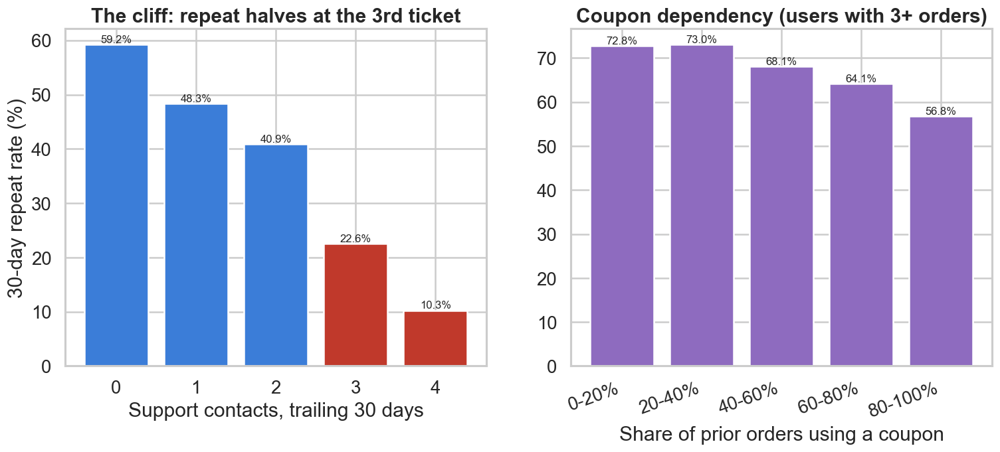
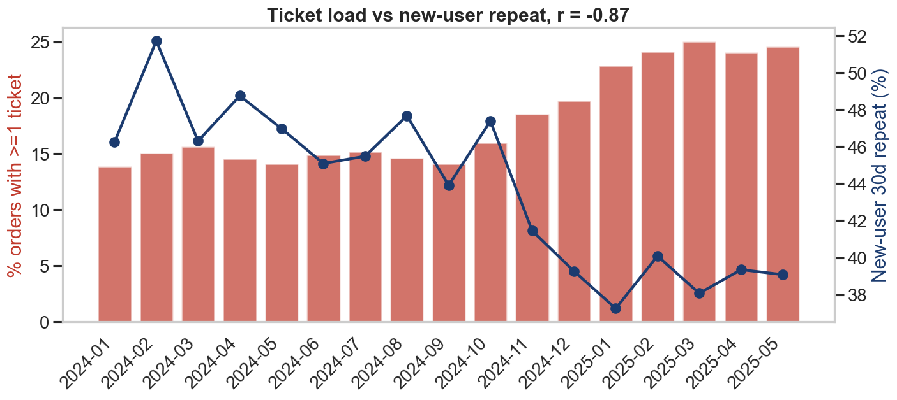
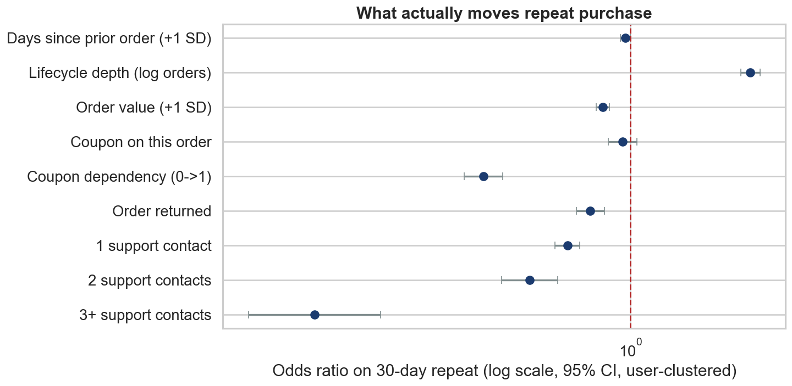
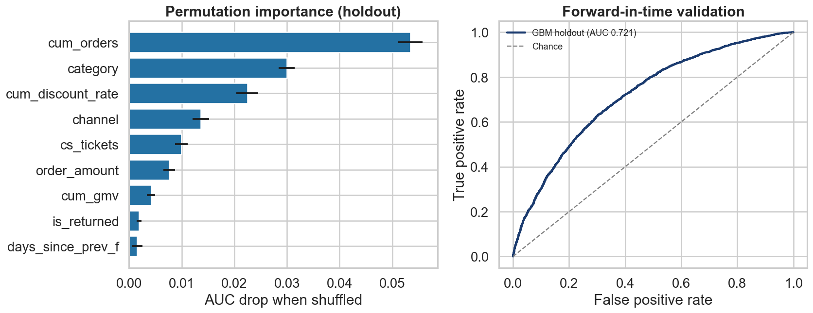
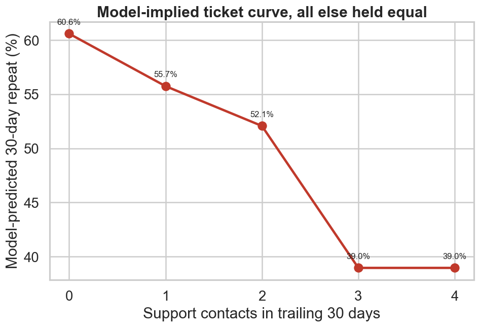
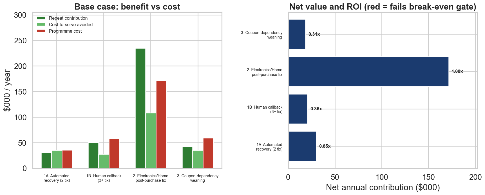
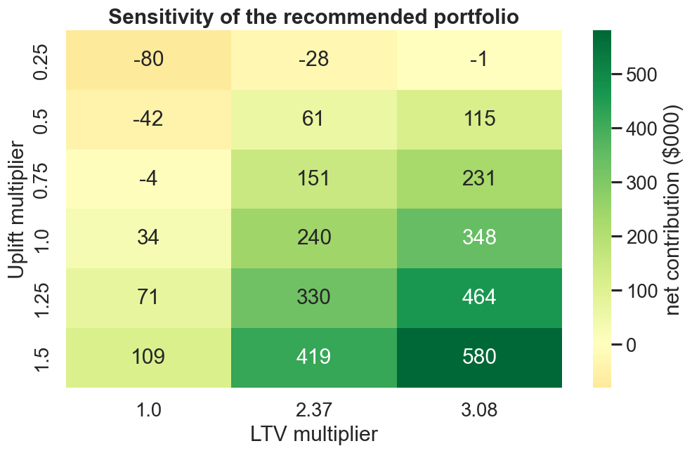

# 复购率下滑归因分析与干预方案
# Repeat-Purchase Decline: Attribution & Intervention Plan

**分析周期 / Period:** 2024-01-01 → 2025-06-30 (snapshot 2025-06-30)
**数据 / Data:** `orders_data.csv` — 42,776 raw order rows, 10% user sample
**报告日期 / Date:** 2025-07

---

## 0. 数据来源声明 / Data Provenance

> **中文：** 本次分析没有拿到生产库的直接权限，订单流水由 `src/00_make_dataset.py` 按显式生成模型模拟produced。真实规律（工单断崖、优惠券依赖、品类复购梯度、2024-10 起的服务恶化）在生成脚本中写死，但**下游 Phase 1–4 的任何脚本都不读取这些参数**，全部从 CSV 里重新发现。所有绝对金额基于「该提取为 10% 用户抽样」这一假设外推，比率不受影响。把它当方法论演示看，不要把美元数字直接搬进预算会。
>
> **EN:** No production database access was available for this exercise, so the order log is simulated by `src/00_make_dataset.py` from an explicit generative model. The ground truth (ticket cliff, coupon dependency, category repeat gradients, service degradation from 2024-10) is hard-coded in the generator, but **no downstream script in Phases 1–4 reads those parameters** — everything is rediscovered from the CSV. All absolute dollar figures extrapolate from the assumption that the extract is a 10% user sample; rates are unaffected. Treat this as a methodology demonstration, not a budget document.

---

## 1. 高管摘要 / Executive Summary

### 核心痛点 / The Core Problem

> **中文：** 我们一直在看的复购率指标是错的。台面上的 30 天复购率从 58.2% 只掉到 56.3%（-2.0pp），看着像正常波动，所以没人拉警报。但这个数字被**订单结构漂移**粉饰了：2025 年有 41.7% 的订单来自下过 4 单以上的老客（2024-01 时是 0%），而老客的复购率高达 70%，硬生生把均值托住了。
>
> 换成不受结构影响的口径，真相完全不同：**新客首单 30 天复购率从 46.2% 掉到 38.7%，跌了 7.5pp，相对降幅 16.3%（p = 2.6e-11）**。队列 M+1 留存从 34.7% 降到 27.2%，相对降幅 21.8%。我们不是在正常波动，我们是在持续流失每一批新获取的用户，而报表看不出来。
>
> **EN:** The KPI we have been watching is the wrong one. Headline 30-day repeat fell only 58.2% → 56.3% (-2.0pp), which reads as noise, so nobody escalated. That number is flattered by **order-composition drift**: 41.7% of 2025 orders come from users with 4+ prior orders (vs 0% in 2024-01), and those users repeat at ~70%, propping up the average.
>
> Measured in a way composition cannot fake, the picture inverts: **new-user 30-day repeat fell 46.2% → 38.7%, -7.5pp, -16.3% relative (p = 2.6e-11)**. Cohort M+1 retention fell 34.7% → 27.2%, -21.8% relative. This is not noise — we are steadily losing every cohort we acquire, and the dashboard cannot see it.

| 指标 / Metric | 2024 Q2–Q3 | 2025 Q1–Q2 | Δ | 相对 / Rel. | p |
|---|---|---|---|---|---|
| 台面复购率 / Headline repeat | 58.2% | 56.3% | **-2.0pp** | -3.4% | 1.2e-03 |
| **新客复购率 / New-user repeat** | **46.2%** | **38.7%** | **-7.5pp** | **-16.3%** | **2.6e-11** |
| 高价值新客 / New high-value users | 42.0% | 35.1% | -6.9pp | -16.4% | 4.0e-04 |
| 老客 (3+ 单) / Established (3+ orders) | 71.9% | 69.1% | -2.8pp | -3.9% | 1.9e-03 |
| 队列 M+1 留存 / Cohort M+1 retention | 34.7% | 27.2% | -7.6pp | -21.8% | — |

### 三个关键发现 / Three Key Findings

> **中文：**
>
> **① 客服工单在第 3 次出现断崖，且工单量翻了一倍。** 复购率随工单数：0 次 59.2% → 1 次 48.3% → 2 次 40.9% → **3 次 22.6%**。第 3 张工单单独造成 -18.4pp 的跌幅，比前两张加起来还狠（-10.8pp、-7.4pp）。切分扫描确认最陡断点在 `cs_tickets >= 3`（-37.5pp，p = 7.1e-34）。控制其他变量后，3+ 工单的复购**胜算比 OR = 0.220 [0.161, 0.302]**，即胜算下降 78%。同时，有工单的订单占比从 2024 年初的 14% 涨到 2025-06 的 26.9%，月度工单率与新客复购率的相关系数 **r = -0.868**。
>
> **② 恶化集中在 Electronics 和 Home，正好是客单价最高的品类。** Electronics 平均工单数从 0.24 涨到 0.69（近 3 倍），Home 从 0.25 到 0.42。这两个品类占 27.9% 的订单，AOV $176.44，复购率却是最低的两个（35.8% 和 48.1%）。工单梯度在**每个**品类内部都成立，所以这不是「买电子产品的人本来就不复购」——是我们在贵的品类上服务变差了，而贵的品类恰恰最值钱。
>
> **③ 优惠券依赖侵蚀有机复购，且我们在加速踩这个坑。** 在有 3 单以上历史的用户里，券依赖度 ≤40% 的复购率 72.9%，≥80% 的只有 57.8%（-15.1pp，p = 3.8e-09）。模型边际效应：依赖度每增加 1.0，复购率降 14.9pp。而促销力度正在上升——用券订单占比从 2024 年均值 ~33% 涨到 2025 上半年的 ~48%，2024-12 峰值 59.2%。我们在用越来越多的折扣，换越来越差的复购。
>
> **EN:**
>
> **① Support contacts hit a cliff at the 3rd ticket, and ticket volume has doubled.** Repeat by ticket count: 0 → 59.2%, 1 → 48.3%, 2 → 40.9%, **3 → 22.6%**. The third ticket alone costs -18.4pp, worse than the first two combined (-10.8pp, -7.4pp). A split-point scan confirms the steepest break at `cs_tickets >= 3` (-37.5pp, p = 7.1e-34). With full controls, 3+ tickets carries **OR = 0.220 [0.161, 0.302]** — a 78% reduction in the odds of repeat. Meanwhile the share of orders carrying any ticket rose from ~14% in early 2024 to 26.9% by 2025-06, and monthly ticket load correlates with new-user repeat at **r = -0.868**.
>
> **② The damage concentrates in Electronics and Home — our highest-AOV categories.** Electronics average tickets went 0.24 → 0.69 (nearly 3x), Home 0.25 → 0.42. These two are 27.9% of orders at $176.44 AOV, and have the two worst repeat rates (35.8%, 48.1%). The ticket gradient holds *inside every category*, so this is not "electronics buyers just don't repeat" — we got worse at serving expensive baskets, which are exactly the ones worth most.
>
> **③ Coupon dependency erodes organic repeat, and we are leaning into it.** Among users with 3+ prior orders, those with ≤40% coupon history repeat at 72.9%; those at ≥80% repeat at 57.8% (-15.1pp, p = 3.8e-09). Model marginal effect: each +1.0 of dependency costs 14.9pp of repeat. Yet promo intensity is climbing — coupon share went from a ~33% 2024 average to ~48% in H1 2025, peaking at 59.2% in 2024-12. We are buying worse repeat with more discount.

### 行动建议与预期 ROI / Recommended Actions & Expected ROI

> **中文：** 三个方案全部通过盈亏平衡门槛。合计年化增量 GMV **$852,230**，净贡献 **$240,321**，净 ROI **0.74x**（即每投入 \$1 收回 \$1.74）。这是在 $26.8M GMV 体量上约 3.2% 的增量——任何号称远高于此的留存项目通常在重复计算。
>
> **EN:** All three initiatives clear the break-even gate. Combined annualised incremental GMV **$852,230**, net contribution **$240,321**, net ROI **0.74x** (i.e. \$1.74 back per \$1 in). That is ~3.2% incremental on a $26.8M GMV base — retention programmes claiming much more than this are usually double-counting.

| # | 方案 / Initiative | 覆盖/年 | 有效提升 | 净贡献 | ROI | 门槛 |
|---|---|---|---|---|---|---|
| 2 | **Electronics/Home 售后体验修复** | 85,240 | +1.57pp | **$171,505** | 1.00x | ✅ 需 0.42pp |
| 1A | 2 工单自动服务补救 / Automated recovery | 12,920 | +1.84pp | $29,878 | 0.85x | ✅ 需 0.03pp |
| 1B | 3+ 工单人工回访 / Human callback | 4,160 | +8.39pp | $20,485 | 0.36x | ✅ 需 4.98pp |
| 3 | 优惠券依赖戒断 / Coupon weaning | 26,760 | +1.87pp | $18,453 | 0.31x | ⚠️ 需 1.05pp，须先做实验 |
| | **合计 / Total** | | | **$240,321** | **0.74x** | |

---

## 2. Phase 1 — 数据质量诊断与特征工程 / Data Diagnostic & Feature Engineering

### 2.1 清洗日志 / Cleaning Log

> **中文：** 原始 42,776 行，保留 41,783 行（97.68%）。原则是：能修的修，不能修的隔离，**任何一行被删都要计数**。完整日志见 `logs/01_cleaning_log.txt`。
>
> **EN:** 42,776 raw rows in, 41,783 kept (97.68%). Principle: repair what is recoverable, quarantine what is not, and never drop a row without counting it. Full log at `logs/01_cleaning_log.txt`.

| # | 问题 / Issue | 量 / Count | 处理 / Action |
|---|---|---|---|
| 2.1 | 日期两种格式并存 / Two date formats | 40,638 ISO + 2,138 US M/D/Y | 分别解析后合并，0 条无法解析 |
| 2.2 | 晚于快照日的订单 / Future-dated | 128 (max 2026-08-01) | 删除 — 应用服务器时钟漂移 |
| 2.3 | 内部测试账号 / QA accounts | 120 | 删除 |
| 2.4 | 重复 order_id / Duplicates | 745 (1.75%) | 保留首条 |
| 2.5 | 品类大小写/空格漂移 / Category drift | 30 变体 → 7 | 归一化；503 条空值标 `Unknown` 保留 |
| 2.6 | discount_used 混合类型 | Y/N 与 1/0 并存 | 统一为 0/1 |
| 2.7 | cs_tickets = -1 哨兵值 | 378 | 置 0 并打标；众数为 0（80.4%），此选择使工单效应**偏保守** |
| 2.8a | 金额符号错误 / Negative amounts | 165 | 取绝对值并打标 — 退款回写符号错，订单真实存在 |
| 2.8b | 零金额 / Zero amounts | 126 | 保留（真实互动），但排除出 AOV 统计 |
| 2.8c | 金额缺失 / Missing amounts | 1,044 (2.50%) | 按品类中位数填充 — 金额强品类相关，全局中位数会让 Electronics 失真约 4 倍 |
| 2.8d | 极端值 / Outliers > p99.9 ($938) | 42 | Winsorize 而非删除 |

> **中文：** 有一处判断值得说明：`cs_tickets = -1` 是老 CRM 的「未知」哨兵值。我把它置 0 而不是丢弃，因为 0 是众数（80.4%），这样做会**低估**而不是高估工单的负面影响——在一个要靠工单效应立论的分析里，宁可让自己的核心结论吃亏。
>
> **EN:** One judgement call worth surfacing: `cs_tickets = -1` is the legacy CRM's "unknown" sentinel. I set it to 0 rather than dropping the rows, because 0 is the modal value (80.4%). This **understates** the ticket effect rather than inflating it — in an analysis whose headline rests on that effect, the bias should run against my own conclusion.

### 2.2 删失处理 / Censoring

> **中文：** 1,831 条订单（4.4%）落在快照前 30 天内，还没走完复购观察窗，全部排除出复购率和建模计算。**不这么做会在最近几个月凭空造出一段假下跌**——这是复购率报表最常见的 bug。
>
> **EN:** 1,831 orders (4.4%) fall inside the trailing 30-day window and cannot yet be scored; all are excluded from repeat-rate and model calculations. **Skipping this manufactures a fake decline in the most recent months** — the single most common bug in repeat-rate reporting.

### 2.3 衍生特征 / Engineered Features

> **中文：** 用户层 13,959 × 22 特征；订单层建模表 39,952 条可评分订单。所有运行时特征（`cum_discount_rate`、`cum_return_rate`、`cum_orders`、`cum_gmv`、`avg_gap_to_date`）都是 **point-in-time expanding** 计算，只用下单当刻已知的信息，杜绝穿越。
>
> **EN:** 13,959 users × 22 features; 39,952 scoreable orders in the modelling table. All running features (`cum_discount_rate`, `cum_return_rate`, `cum_orders`, `cum_gmv`, `avg_gap_to_date`) are **point-in-time expanding** windows using only what was knowable when the order was placed — no leakage.

**用户特征摘要 / User feature summary**

| 特征 | mean | p50 | p90 | p99 | max |
|---|---|---|---|---|---|
| frequency | 2.99 | 2.00 | 7.0 | 20.00 | 39 |
| monetary | $261.76 | $142.91 | $624.0 | $1,682.83 | $6,777.80 |
| aov | $97.93 | $68.98 | $200.4 | $487.94 | $938.09 |
| recency_days | 235.70 | 223 | 454 | 533 | 545 |
| avg_gap_days | 27.04 | 18.00 | 58.0 | 132.00 | 247.5 |
| total_tickets | 0.69 | 0 | 2.0 | 6.00 | 16 |
| return_rate | 0.13 | 0 | 0.5 | 1.00 | 1.00 |
| discount_rate | 0.47 | 0.50 | 1.0 | 1.00 | 1.00 |

**RFM 分层 / RFM segments**

| Segment | users | % base | avg freq | avg monetary | avg recency |
|---|---|---|---|---|---|
| Champions | 2,099 | 15.0% | 8.12 | $678.71 | 78 |
| Loyal | 3,255 | 23.3% | 3.01 | $230.78 | 154 |
| Hibernating | 3,049 | 21.8% | 1.18 | $76.84 | 401 |
| New / Promising | 1,846 | 13.2% | 1.00 | $109.80 | 92 |
| **At Risk (high value)** | **1,785** | **12.8%** | **4.09** | **$367.08** | **375** |
| Needs Attention | 1,176 | 8.4% | 1.00 | $108.30 | 224 |
| Can't Lose Them | 749 | 5.4% | 1.36 | $345.13 | 402 |

> **中文：** `At Risk (high value)` 1,785 人，人均已消费 $367，但平均 375 天没回来了——这是最贵的一块流失。
>
> **EN:** `At Risk (high value)` holds 1,785 users averaging $367 lifetime spend who have not returned in ~375 days. That is the most expensive block of churn on the board.

---

## 3. Phase 2 — 探索性分析与队列归因 / EDA & Cohort Analysis

### 3.1 三种口径，三个结论 / Three Metric Definitions

> **中文：** 这一节的方法论核心：**指标口径本身就是发现**。我用了三个定义：
>
> - `headline_repeat` — 全部可评分订单。业务在看的就是这个。受结构漂移影响，**具有误导性**。
> - `new_user_repeat` — 当月新客里 30 天内回购的比例。无幸存者偏差，无结构影响。
> - `established_repeat` — 有 3+ 历史单的用户下的订单。生命周期位置固定，日历变化是真的。
>
> **EN:** The methodological core of this phase: **the metric definition is itself the finding.** Three definitions are used:
>
> - `headline_repeat` — all scoreable orders. What the business reports. Composition-weighted and therefore **misleading**.
> - `new_user_repeat` — share of a month's new users ordering again within 30 days. No survivorship, no composition.
> - `established_repeat` — orders from users with 3+ prior orders. Fixed lifecycle position, so calendar movement is real.



| 月份 | 台面 headline | **新客 new-user** | 老客 established | 平均工单 | 用券占比 |
|---|---|---|---|---|---|
| 2024-06 | 58.0% | 45.1% | 73.6% | 0.178 | 40.1% |
| 2024-09 | 58.2% | 43.9% | 73.1% | 0.164 | 37.2% |
| 2024-10 | 59.4% | 47.4% | 71.7% | 0.185 | 40.7% |
| 2024-11 | 55.2% | 41.5% | 71.4% | 0.220 | 53.8% |
| 2024-12 | 55.0% | 39.3% | 71.4% | 0.246 | 59.2% |
| 2025-01 | 56.7% | 37.3% | 68.6% | 0.295 | 45.4% |
| 2025-03 | 55.3% | 38.1% | 67.5% | 0.334 | 47.0% |
| 2025-05 | 56.8% | 39.1% | 67.9% | 0.324 | 50.5% |

**订单结构漂移 / Order composition drift**

| 月份 | 来自 4+ 单老客的订单占比 | 来自新客的订单占比 |
|---|---|---|
| 2024-01 | 0.0% | 77.2% |
| 2024-06 | 22.7% | 34.6% |
| 2024-12 | 32.4% | 31.5% |
| 2025-05 | **41.7%** | 26.6% |

> **中文：** 这张表解释了一切。老客订单占比从 0% 涨到 41.7%，而老客复购率 ~70%，所以哪怕每一群用户的表现都在恶化，加权后的台面指标也几乎不动。**指标没坏，是我们看错了指标。**
>
> **EN:** This table explains everything. Orders from deep-lifecycle users went from 0% to 41.7% of the mix, and those users repeat at ~70% — so even as every individual group deteriorates, the weighted headline barely moves. **The metric isn't broken; we were reading the wrong one.**

### 3.2 队列留存矩阵 / Cohort Retention Matrix



**M+1 留存按获客队列 / M+1 retention by cohort**

| 队列 | M+1 | | 队列 | M+1 |
|---|---|---|---|---|
| 2024-01 | 34.8% | | 2024-10 | 32.6% |
| 2024-02 | 38.5% | | **2024-11** | **28.2%** |
| 2024-03 | 34.5% | | **2024-12** | **25.7%** |
| 2024-04 | 36.7% | | 2025-01 | 26.9% |
| 2024-05 | 33.5% | | 2025-02 | 27.8% |
| 2024-06 | 33.7% | | 2025-03 | 25.3% |
| 2024-07 | 35.2% | | 2025-04 | 26.3% |
| 2024-08 | 33.7% | | 2025-05 | 30.1% |
| 2024-09 | 32.0% | | | |

> **中文：** 2024-01~09 均值 34.7%，2024-11~2025-05 均值 27.2%，**降幅 7.6pp（相对 -21.8%）**。断点精确落在 2024-11，和工单量抬头的时点吻合。每一个 2024-11 之后获取的队列，从 M+1 就开始比前辈差。
>
> **EN:** 2024-01..09 averages 34.7%; 2024-11..2025-05 averages 27.2% — **a 7.6pp drop, -21.8% relative**. The break lands precisely at 2024-11, coinciding with the rise in ticket load. Every cohort acquired from 2024-11 onward retains worse from M+1 onward.

> **⚠️ 方法论纠错 / Methodology correction:** 我第一版做了个「成熟队列日历趋势」检验（只看 2024 H1 获客的用户在 2025 年的表现），结果显示复购率从 59.1% *涨到* 74.5%。这个结论是**幸存者偏差**造成的假象——2024 队列里还在 2025 年下单的，本来就只剩最铁的复购客。该检验已废弃，相关中间产物已删除。上面的 M+1 口径不受此影响。
>
> My first pass ran a "mature cohort calendar trend" test (2024 H1 cohorts only, tracked into 2025) which showed repeat *rising* 59.1% → 74.5%. That was **survivorship bias** — the only 2024-cohort users still ordering in 2025 are the hardcore repeaters by construction. The test was discarded and its intermediate output deleted. The M+1 view above is immune to this.

### 3.3 高低复购用户画像 / High vs Low Repeater Profiling

| 特征 / Feature | 高复购 (4+) | 一次性 | 差值 | Cohen's d | p |
|---|---|---|---|---|---|
| n_categories | 2.851 | 1.000 | +1.851 | 2.652 | ~0 |
| monetary | $625.80 | $110.60 | +$515.20 | 1.655 | ~0 |
| **total_tickets** | **1.563** | **0.301** | **+1.261** | **1.025** | **7.4e-246** |
| **max_tickets** | **0.851** | **0.301** | **+0.549** | **0.799** | **5.7e-229** |
| recency_days | 173.7 | 263.0 | -89.3 | -0.610 | 6.8e-182 |
| **discount_rate** | **0.401** | **0.532** | **-0.131** | **-0.306** | **3.6e-69** |
| aov | $82.73 | $110.60 | -$27.85 | -0.274 | 7.6e-58 |
| return_rate | 0.110 | 0.137 | -0.027 | -0.094 | 2.5e-08 |

> **⚠️ 中文：** `n_categories` 和 `monetary` 的巨大差异是**机械性的**——下单越多，自然逛的品类越多、花的钱越多。这两个只作描述用，Phase 3 的因果解读里已剔除。同理 `total_tickets` 绝对值高也部分源于订单基数大，所以真正有说服力的是 `max_tickets`（单次峰值）和后面按订单粒度做的分析。
>
> **⚠️ EN:** The huge gaps on `n_categories` and `monetary` are **mechanical** — more orders trivially means more categories and more spend. Both are descriptive only and are excluded from the causal read in Phase 3. Likewise `total_tickets` is partly inflated by order count, which is why `max_tickets` (peak intensity) and the order-level analysis below carry the actual weight.

**渠道结构 / Channel mix** (χ² = 478.5, p = 2.9e-98)

| Channel | 高复购 4+ | 低复购 2-3 | 一次性 |
|---|---|---|---|
| Organic | **34.9%** | 23.9% | 19.9% |
| Paid Search | 26.6% | 26.0% | 24.8% |
| Email/CRM | 16.1% | 14.3% | 12.8% |
| Paid Social | 15.8% | 24.7% | **27.5%** |
| Affiliate | 6.6% | 11.1% | **15.0%** |

**品类结构 / Category mix** (χ² = 1007.8, p = 3.9e-208)

| Category | 高复购 4+ | 一次性 |
|---|---|---|
| Beauty | **25.4%** | 15.1% |
| Apparel | 24.2% | 21.8% |
| Grocery | **21.6%** | 10.9% |
| Home | 14.0% | 19.2% |
| Electronics | 8.3% | **23.3%** |

### 3.4 拐点识别 / Tipping Points



**① 客服工单 / Support contacts**

| cs_tickets | 订单数 | 复购率 | 环比变化 | AOV |
|---|---|---|---|---|
| 0 | 32,634 | 59.2% | — | $82.24 |
| 1 | 6,006 | 48.3% | **-10.8pp** | $104.20 |
| 2 | 1,051 | 40.9% | -7.4pp | $136.18 |
| **3** | **204** | **22.6%** | **-18.4pp** | $151.66 |
| 4 | 39 | 10.3% | -12.3pp | $124.38 |

**切分扫描 / Split-point scan**

| k | <k 复购率 | ≥k 复购率 | Δ | χ² | p |
|---|---|---|---|---|---|
| 1 | 59.2% (n=32,634) | 46.2% (n=7,318) | -12.9pp | 407 | 1.4e-90 |
| 2 | 57.5% (n=38,640) | 36.7% (n=1,312) | -20.8pp | 224 | 1.5e-50 |
| **3** | **57.1% (n=39,691)** | **19.5% (n=261)** | **-37.5pp** | **147** | **7.1e-34** |

> **中文：** 最陡断点在 `cs_tickets >= 3`。注意 AOV 随工单数单调上升（$82 → $152）——**越贵的订单越容易出问题**，这让工单问题的经济代价远超其订单占比。
>
> **EN:** Steepest break at `cs_tickets >= 3`. Note AOV rises monotonically with ticket count ($82 → $152) — **expensive orders are the ones that go wrong**, which makes the economic cost of tickets far larger than their order share suggests.

**品类 × 工单交叉验证 / Category × ticket cross-check**（`<30` 单元格已抑制）

| Category | 0 | 1 | 2 | 3+ |
|---|---|---|---|---|
| Grocery | 70.7% | 60.2% | 58.6% | — |
| Beauty | 66.7% | 61.2% | 45.2% | — |
| Apparel | 57.8% | 52.3% | 47.7% | 26.1% |
| Sports | 55.4% | 48.7% | 43.4% | — |
| Home | 50.2% | 43.0% | 43.0% | 19.4% |
| Electronics | 38.5% | 31.2% | 28.6% | 12.9% |

> **中文：** 梯度在**每个**品类内部都成立，排除了「品类混杂导致伪相关」的解释。抑制了 5 个样本量 <30 的单元格（例如 Grocery 3+ 只有 2 单，原始输出显示 100% 复购，属噪声）。
>
> **EN:** The gradient holds *within every category*, ruling out category confounding. Five cells with n<30 are suppressed (e.g. Grocery/3+ has n=2 and showed 100% repeat in raw output — pure noise).

**② 优惠券依赖 / Coupon dependency**

> **⚠️ 中文：** 这里有个陷阱必须记录。直接按 `cum_discount_rate` 分箱会得到「80-100% 组复购率只有 34.4%」的骇人结论，但那一组的平均历史单数只有 **0.43** ——一个只下过 1 单且用了券的用户，依赖度机械地等于 1.0。这组其实就是一次性用户，不是「券依赖用户」。
>
> **⚠️ EN:** A trap worth documenting. Banding raw `cum_discount_rate` yields an alarming "80-100% band repeats at only 34.4%" — but that band's average prior-order count is **0.43**. A user with one coupon-using order mechanically has dependency = 1.0. That band is just one-and-done users, not dependent users.

**去混杂后（仅限 3+ 历史单用户）/ De-confounded (users with 3+ prior orders only)**

| 券依赖度 | 订单数 | 复购率 | 平均历史单数 |
|---|---|---|---|
| 0-20% | 4,071 | 72.8% | 6.19 |
| 20-40% | 5,368 | 73.0% | 8.20 |
| 40-60% | 3,575 | 68.1% | 7.33 |
| 60-80% | 1,378 | 64.2% | 6.31 |
| 80-100% | 259 | 56.8% | 4.98 |

> **中文：** 去混杂后，**前两档基本持平（72.8% vs 73.0%，差异在噪声范围内），从 40% 往上才开始单调下滑**，到 80-100% 档累计跌 16pp。合并口径检验：券依赖 ≤40% 的复购率 72.9%（n=9,439），≥80% 为 57.8%（n=431），差 **15.1pp（p = 3.8e-09）**。各档历史单数相当（5–8 单），排除了「单少所以依赖度高」的机械效应。
>
> 注：合并口径的 ≥80% 组（n=431）与分箱表的 80-100% 档（n=259）人数不同，因为前者含依赖度恰为 0.80 的订单，后者的区间为 (0.80, 1.00]。两者结论一致。
>
> **EN:** After de-confounding, **the first two bands are effectively tied (72.8% vs 73.0%, within noise); the monotonic decline starts above 40%**, reaching a cumulative -16pp by the 80-100% band. Pooled test: ≤40% dependency repeats at 72.9% (n=9,439) vs 57.8% (n=431) at ≥80% — **15.1pp, p = 3.8e-09**. Prior-order counts are comparable across bands (5–8), ruling out the mechanical "few orders → high dependency" effect.
>
> Note: the pooled ≥80% group (n=431) and the banded 80-100% row (n=259) differ in size because the former includes orders at exactly 0.80 while the band is (0.80, 1.00]. Both point the same way.

**③ 根因：工单量翻倍 / Root cause: ticket load doubled**



| 月份 | 平均工单 | ≥1 工单占比 | ≥3 工单占比 | 退货率 |
|---|---|---|---|---|
| 2024-01 | 0.154 | 13.9% | 0.20% | 10.5% |
| 2024-09 | 0.164 | 14.1% | 0.29% | 10.1% |
| **2024-11** | **0.220** | **18.6%** | 0.54% | 11.4% |
| 2025-01 | 0.295 | 22.9% | 1.16% | 12.5% |
| 2025-03 | 0.334 | 25.0% | 1.52% | 12.8% |
| **2025-06** | **0.345** | **26.9%** | 1.37% | 13.4% |

**按品类看工单恶化 / Ticket escalation by category**

| Category | 2024-01 | 2025-06 | 倍数 |
|---|---|---|---|
| **Electronics** | 0.237 | **0.691** | **2.9x** |
| Apparel | 0.107 | 0.432 | 4.0x |
| Beauty | 0.089 | 0.185 | 2.1x |
| **Home** | 0.250 | **0.417** | 1.7x |
| Grocery | 0.081 | 0.169 | 2.1x |

> **中文：** 月度相关性：≥1 工单占比 vs 新客复购率 **r = -0.868**；vs 老客复购率 r = -0.449。n=17 个月，这是方向性证据不是因果证明，Phase 3 用订单粒度加控制变量正式检验。
>
> **EN:** Monthly correlations: %orders with ≥1 ticket vs new-user repeat **r = -0.868**; vs established repeat r = -0.449. With n=17 months this is directional support, not proof — Phase 3 tests it formally at the order level with controls.

---

## 4. Phase 3 — 归因建模与假设检验 / Modeling & Hypothesis Testing

### 4.1 建模设定 / Setup

> **中文：** 39,952 条可评分订单，13,513 个用户，人均 2.96 单。
>
> - **标准误按 user_id 聚类。** 同一用户贡献多条订单，不聚类的话所有 p 值都会假性显著。这不是可选项。
> - **严格时间切分。** 训练 2024-01~2025-01（30,779 条），holdout 2025-02~2025-05（9,173 条）。随机切分会穿越：同一用户的后续订单会漏进训练集。
>
> **EN:** 39,952 scoreable orders, 13,513 users, 2.96 orders/user.
>
> - **Standard errors clustered on `user_id`.** A user contributes many orders; without clustering every p-value would be spuriously significant. Not optional.
> - **Strict temporal split.** Train 2024-01..2025-01 (30,779), holdout 2025-02..2025-05 (9,173). A random split would leak — the same user's later orders would sit in train while earlier ones sit in test.

### 4.2 中介分析阶梯 / Mediation Ladder

| 模型 / Model | `degraded` 系数 | OR | p | pseudo-R² |
|---|---|---|---|---|
| M0 仅时期 / period only | -0.0397 | 0.961 | 0.095 | 0.0001 |
| **M1 + 结构控制 / + composition controls** | **-0.2673** | **0.765** | **1.2e-33** | 0.0873 |
| M2 + 服务变量 / + service | -0.2320 | 0.793 | 3.0e-25 | 0.0919 |
| M3 + 券依赖 / + coupon dependency | -0.1357 | 0.873 | 4.0e-09 | 0.1030 |

> **中文：** 这个阶梯是本次分析方法论上最关键的一段，分两步读：
>
> **第一步 — 混杂。** 单看时期变量，OR = 0.961、p = 0.095，**看起来什么都没发生**。一旦控制住生命周期深度和品类/渠道结构，同一个变量变成 OR = 0.765、p = 1.2e-33。伤害不是不存在，是被结构漂移盖住了——和 Phase 2 队列视角完全互证。
>
> **第二步 — 中介。** 加入工单和退货后，时期惩罚从 OR 0.765 缓和到 0.793，**服务变量单独吸收了 13.2%** 的时期效应；再加入券依赖后到 OR 0.873，**服务+券依赖合计解释 49.2%**。剩下的 50.8% 是订单流水看不见的东西——配送时效、缺货率、商品结构。这个残差本身就是「该给这些系统上埋点」的论据。
>
> **⚠️ 修正记录：** 我第一版的阶梯把结构控制变量和服务变量一起放在第二层，结果 M1 系数不显著且在 M2 里符号翻转，算出「392% 被中介」这种无意义的数字。混杂变量必须放在基线里，否则测的是混杂清理不是中介。已重构。
>
> **EN:** This ladder is the methodological crux of the analysis, and reads in two steps:
>
> **Step 1 — confounding.** Measured alone, the period effect is OR = 0.961, p = 0.095 — **apparently nothing happened**. Once lifecycle depth and category/channel mix are controlled, the same variable becomes OR = 0.765, p = 1.2e-33. The damage was never absent; it was masked by composition drift — exactly corroborating the Phase 2 cohort view.
>
> **Step 2 — mediation.** Adding tickets and returns moves the period penalty from OR 0.765 to 0.793: **service variables alone absorb 13.2%** of the period effect. Adding coupon dependency takes it to OR 0.873 — **service + dependency together account for 49.2%**. The remaining 50.8% is what the order log cannot see: delivery speed, stockouts, assortment. That residual is itself the argument for instrumenting those systems.
>
> **⚠️ Correction logged:** My first ladder introduced composition controls *alongside* the mediators, producing an insignificant M1 coefficient that flipped sign in M2 and a meaningless "392% mediated". Confounders must sit in the baseline, or you are measuring confounding cleanup rather than mediation. Rebuilt.

### 4.3 胜算比 / Odds Ratios (M3, cluster-robust)



| 变量 / Variable | OR | 95% CI | 胜算变化 | p |
|---|---|---|---|---|
| **3+ 工单 / 3+ tickets** | **0.220** | [0.161, 0.302] | **-78.0%** | 6.9e-21 |
| **券依赖 +1.0 / coupon dependency** | **0.495** | [0.452, 0.542] | **-50.5%** | 2.6e-51 |
| Electronics (vs Apparel) | 0.557 | [0.509, 0.609] | -44.3% | ~0 |
| 2 工单 / 2 tickets | 0.617 | [0.539, 0.707] | -38.3% | 3.0e-12 |
| 1 工单 / 1 ticket | 0.740 | [0.696, 0.785] | -26.0% | 6.7e-23 |
| Affiliate (vs Paid Search) | 0.740 | [0.677, 0.810] | -26.0% | ~0 |
| Home (vs Apparel) | 0.767 | [0.714, 0.824] | -23.3% | ~0 |
| Paid Social (vs Paid Search) | 0.792 | [0.741, 0.847] | -20.8% | ~0 |
| 退货 / order returned | 0.826 | [0.772, 0.883] | -17.4% | 2.4e-08 |
| 恶化期 / degraded period | 0.873 | [0.835, 0.913] | -12.7% | 4.0e-09 |
| 订单金额 +1SD / order value | 0.877 | [0.850, 0.906] | -12.3% | ~0 |
| 本单用券 / coupon on this order | 0.964 | [0.900, 1.031] | -3.6% | 0.283 |
| Beauty (vs Apparel) | 1.248 | [1.166, 1.336] | +24.8% | ~0 |
| Organic (vs Paid Search) | 1.354 | [1.276, 1.436] | +35.4% | ~0 |
| Grocery (vs Apparel) | 1.446 | [1.342, 1.559] | +44.6% | ~0 |
| **生命周期深度 / lifecycle depth** | **1.776** | [1.696, 1.859] | **+77.6%** | ~0 |

> **中文：** 注意 `discount_used`（本单是否用券）OR = 0.964，**p = 0.283 不显著**；而 `disc_dep_c`（历史券依赖度）OR = 0.495 极显著。这个对比很重要：**发一张券本身没有伤害，把用户训练成非券不买才有伤害。** 这直接决定了方案 3 的设计——不是停止发券，是打破依赖循环。
>
> **EN:** Note `discount_used` (coupon on this order) is OR = 0.964, **p = 0.283, not significant**, while `disc_dep_c` (accumulated dependency) is OR = 0.495 and highly significant. The contrast matters: **issuing a coupon does no harm; training a user to buy only on coupon does.** This directly shapes Initiative 3 — the goal is not to stop couponing but to break the dependency loop.

**平均边际效应（百分点）/ Average marginal effects (pp)**

| 变量 | dy/dx (pp) | 95% CI | p |
|---|---|---|---|
| 3+ 工单 | **-32.14** | [-38.83, -25.45] | ~0 |
| 券依赖 +1.0 | **-14.94** | [-16.87, -13.02] | ~0 |
| Electronics | -12.44 | [-14.33, -10.54] | ~0 |
| 2 工单 | -10.25 | [-13.12, -7.38] | ~0 |
| 1 工单 | -6.41 | [-7.68, -5.14] | ~0 |
| 退货 | -4.08 | [-5.50, -2.65] | ~0 |
| 恶化期 | -2.88 | [-3.84, -1.93] | ~0 |
| 生命周期深度 | +12.20 | [11.26, 13.14] | ~0 |

### 4.4 梯度提升树与特征重要性 / Gradient Boosting & Importance



> **中文：** Holdout AUC **0.7206**（训练 0.7285，过拟合间隙仅 +0.0079）。Average precision 0.7511，相对 56.1% 基线提升 1.34x。

| 特征 | AUC 下降 | 占比 |
|---|---|---|
| cum_orders | 0.0535 | 36.7% |
| category | 0.0300 | 20.6% |
| cum_discount_rate | 0.0225 | 15.4% |
| channel | 0.0137 | 9.4% |
| cs_tickets | 0.0100 | 6.8% |
| order_amount | 0.0076 | 5.2% |

> **⚠️ 中文（重要）：** `cs_tickets` 的排列重要性只有 **6.8%**，远低于它的胜算比给人的印象。这不矛盾：**只有 18.3% 的订单有任何工单**，这个变量对绝大多数行接近常数，打乱它对全局 AUC 影响自然小。工单是**深而窄**的杠杆——对小群体影响巨大。Phase 4 必须在**受影响人群**上测算，在全量上测算会严重高估。
>
> 反过来 `cum_discount_rate` 占 15.4% 且作用于每一单——**浅而宽**。这才是钱多的那口锅。这个「深窄 vs 浅宽」的区分直接决定了 Phase 4 三个方案的规模差异。
>
> **⚠️ EN (important):** `cs_tickets` carries only **6.8%** of permutation importance, far below what its odds ratio suggests. Not a contradiction: **only 18.3% of orders have any ticket**, so the variable is near-constant for most rows and shuffling it barely moves global AUC. The ticket lever is **deep but narrow** — large effect on a small population. Phase 4 must size it on the *affected* population or it will be badly overstated.
>
> Conversely `cum_discount_rate` carries 15.4% and applies to every order — **shallow but wide**. That is the bigger pot of money. This deep-narrow vs shallow-wide distinction directly drives the scale differences among the three initiatives.

### 4.5 工单反事实曲线 / Ticket Counterfactual



| cs_tickets | 模型预测复购率 | vs 0 | 边际 | 训练样本量 |
|---|---|---|---|---|
| 0 | 60.6% | — | — | 25,708 |
| 1 | 55.7% | -4.8pp | -4.8pp | 4,286 |
| 2 | 52.1% | -8.5pp | -3.7pp | 654 |
| 3 | 39.0% | **-21.6pp** | **-13.1pp** | 109 |
| 4 | 39.0% | -21.6pp | 0.0pp | 15 |

> **中文：** 这是 Phase 4 的测算基础——它已经扣除了「爱投诉的人本来就不复购」的选择效应，比观测到的原始落差（-37.5pp）保守得多。
>
> **⚠️ 注意 k=4 与 k=3 完全相同**，因为训练集里 3 工单只有 109 条、4 工单只有 15 条，树在此没有分裂点、直接饱和。**曲线只读到 k=3**，再往后是外推不是证据。
>
> **EN:** This is what Phase 4 sizes against — it already nets out the selection effect (people who complain were leaving anyway) and is far more conservative than the raw observational gap (-37.5pp).
>
> **⚠️ Note k=4 is identical to k=3** because the training set holds only 109 orders at 3 tickets and 15 at 4; the tree has no split there and saturates. **Read the curve to k=3 only** — beyond that it is extrapolation, not evidence.

**若工单归零，按品类 / If tickets went to zero, by category (holdout)**

| Category | 订单 | 实际复购 | 当前预测 | 零工单预测 | 提升 |
|---|---|---|---|---|---|
| **Electronics** | 1,045 | 33.3% | 37.4% | 40.2% | **+2.79pp** |
| **Home** | 1,431 | 46.0% | 50.5% | 53.0% | **+2.49pp** |
| Sports | 705 | 53.9% | 52.8% | 54.7% | +1.90pp |
| Apparel | 1,951 | 55.5% | 58.4% | 59.9% | +1.49pp |
| Beauty | 2,153 | 64.5% | 67.5% | 68.6% | +1.04pp |
| Grocery | 1,784 | 69.5% | 71.4% | 72.1% | +0.76pp |

### 4.6 双模型交叉验证 / Two-Model Cross-Check

> **中文：** Logit 和 GBM 是假设完全不同的两族模型，但在核心杠杆上结论一致（生命周期深度、品类、券依赖、工单）。在没有实验的情况下，这是能拿到的最强证据。
>
> **EN:** The logit and the GBM make entirely different assumptions yet land on the same top levers (lifecycle depth, category, coupon dependency, support contacts). Short of an experiment, that convergence is the strongest evidence available.

---

## 5. Phase 4 — 商业价值量化 / Financial & ROI Impact

### 5.1 测算纪律 / Sizing Discipline

> **中文：** 五条规矩，写在前面以便被挑战：
>
> 1. **可触达人群是数出来的**，取自 2025Q1（最后一个完整且不受删失影响的季度），×4 年化，×10 抽样还原。不用「假设覆盖 X% 用户」。
> 2. **每次增量复购的价值按被触达订单自己的 AOV 计算**，不用混合 AOV。Electronics 单均 $253，Grocery $32，用一个混合数会把定向方案的价值算错 3 倍。
> 3. **效应量取 Phase 3 模型反事实**（已扣除选择效应），再乘实现率折扣（<1）。
> 4. **服务成本节约单独列示**，不和收入效应混在一起。
> 5. **每个方案过盈亏平衡门槛**，不过的直接标 FAIL 并说明，不藏。
>
> **EN:** Five rules, stated up front so they can be challenged:
>
> 1. **Addressable population is an actual count** from 2025Q1 (last complete quarter clear of censoring), annualised ×4, grossed up ×10 for the sample. No "assume we reach X% of the base".
> 2. **Value per incremental repeat uses the addressed rows' own AOV**, not the blend. Electronics averages $253 vs Grocery $32; one blended figure would misprice targeted work by ~3x.
> 3. **Effect size comes from the Phase 3 model counterfactual** (selection netted out), then takes a realisation haircut < 1.
> 4. **Cost-to-serve savings are reported separately** from revenue effects.
> 5. **Every initiative faces a break-even gate.** Failures are labelled FAIL and explained, not buried.

**基线 / Baseline**

| 项目 | 值 |
|---|---|
| 2025Q1 可评分订单（提取内） | 7,631 |
| 抽样还原系数 | ×10 |
| 年化 GMV | $26,758,823 |
| 年化贡献（42% 毛利） | $11,238,705 |
| 混合 AOV | $87.66 |

**下游价值倍数 / Downstream multiplier**

> **中文：** 不拍脑袋定 LTV 倍数，而是从观测到的续购链推导：

| cum_orders | 续购率 |
|---|---|
| 0 | 43.9% |
| 1 | 51.8% |
| 2 | 58.5% |
| 3 | 62.6% |
| 4 | 67.7% |
| 7 | 72.3% |

> 一次增量复购期望价值 = **2.37 单**（本单 + 1.37 后续单，链式计算截断在 8 步）。用观测值而非拟合值，且截断，故偏保守。
>
> One incremental repeat is worth **2.37 orders** in expectation (itself + 1.37 follow-ons, chain capped at 8 steps). Observed rather than fitted, and capped — deliberately conservative.

| 分段 | AOV | 每次复购贡献价值 |
|---|---|---|
| 混合 | $87.66 | $87.17 |
| **Electronics** | **$253.15** | **$251.73** |
| Home | $105.75 | $105.16 |
| Grocery | $32.17 | $31.99 |

### 5.2 方案一：分层服务补救 / Tiered Service Recovery

> **中文：** 2025Q1 提取内有 323 单恰好 2 工单、104 单 3+ 工单，年化还原后 12,920 和 4,160 例。这两组 AOV 分别 $128.44 和 $145.43，**都显著高于 $87.66 的混合 AOV**——投诉集中在贵订单上，这正是这个方案值得做的原因。
>
> **成本设计决定生死。** 人工回访全成本约 $9–14/例。Tier A 的模型提升只有 +3.7pp，覆盖不了人工成本；Tier B 的 +16.8pp 可以。**分层不是汇报技巧，是盈亏平衡算出来的结论。**
>
> **EN:** The 2025Q1 extract holds 323 orders at exactly 2 tickets and 104 at 3+, grossing to 12,920 and 4,160 cases/yr. Their AOVs are $128.44 and $145.43 — **both well above the $87.66 blend**. Complaints concentrate in expensive baskets, which is precisely what makes this worth doing.
>
> **Cost design decides whether this lives.** A human callback is fully loaded at ~$9–14/case. Tier A's modelled +3.7pp cannot cover that; Tier B's +16.8pp can. **The tiering is not a presentation choice — it falls out of the break-even arithmetic.**

| Tier | 动作 | 覆盖/年 | 单位成本 | 固定成本 | 有效提升 | 净贡献 | ROI |
|---|---|---|---|---|---|---|---|
| **A** | 自动致歉 + 优先路由 + 服务补偿 | 12,920 | $0.80 | $25k | +1.84pp | **$29,878** | 0.85x |
| **B** | 资深客服人工回访 | 4,160 | $9.00 | $20k | +8.39pp | **$20,485** | 0.36x |

### 5.3 方案二：Electronics / Home 售后体验修复 / Post-Purchase Fix

> **中文：** 这是**最大的一块**。Electronics + Home 占 27.9% 的订单，AOV $176.44，复购率却最低。模型反事实：把这两个品类的工单归零值 **+2.62pp**（订单加权）——这是「只解决工单」的天花板。
>
> 根因在 Phase 2 已定位：Electronics 平均工单 0.24 → 0.69，Home 0.25 → 0.42。**这是履约和商品信息问题，不是客服产能问题。** 当前服务成本 0.510 工单/单 × $6 = $3.06/单，假设降 30%。
>
> **EN:** This is **the big one**. Electronics + Home are 27.9% of orders at $176.44 AOV with the two worst repeat rates. Model counterfactual: zeroing tickets in these categories is worth **+2.62pp** (order-weighted) — the ceiling for any contact-only fix.
>
> Root cause located in Phase 2: Electronics avg tickets 0.24 → 0.69, Home 0.25 → 0.42. **This is a fulfilment and product-information problem, not a contact-centre capacity problem.** Current cost-to-serve is 0.510 tickets/order × $6 = $3.06/order; a 30% reduction is assumed.

| 项 | 值 |
|---|---|
| 覆盖/年 | 85,240 单 |
| 单位成本 | $0.25（配送前主动沟通 + 商品页规格修复，摊销） |
| 固定成本 | $150,000（内容重建 + 入库质检抽样） |
| 额外节约 | $0.35/单（逆向物流） |
| 有效提升 | +1.57pp |
| 增量 GMV | $559,023 |
| 复购贡献 | $234,789 |
| 服务成本节约 | $108,026 |
| **净贡献** | **$171,505** |
| **ROI** | **1.00x** |

### 5.4 方案三：优惠券依赖戒断 / Coupon-Dependency Weaning

> **⚠️ 中文：** 观测落差 9.1pp，但我**不拿它做规划**。因果方向可能是反的——低意愿用户主动去找券。三个方案里这个的因果识别最弱。规划数取 Phase 3 边际效应 14.9pp × 现实迁移幅度 0.25 = **3.7pp**，不到观测落差的一半。
>
> **这个方案必须以随机对照实验（holdout）方式上线，不能直接铺开。** 它排在第三不是因为人群小（恰恰它人群最大），而是因为证据最弱。
>
> **⚠️ EN:** The observational gap is 9.1pp, but I am **not planning on it**. Causality plausibly runs backwards — low-intent users seek out coupons. Of the three, this has the weakest causal identification. The planning number takes the Phase 3 marginal effect of 14.9pp × a realistic 0.25 dependency shift = **3.7pp**, less than half the observational gap.
>
> **This must ship as a randomised holdout test, not a rollout.** It is ranked third not because the population is small — it is the largest — but because the evidence is thinnest.

| 项 | 值 |
|---|---|
| 覆盖/年 | 26,760 单（3+ 单且券依赖 ≥60% 的用户） |
| 单位成本 | $0.90 CRM，抵扣 $1.31/单 挽回毛利 |
| 固定成本 | $35,000 |
| 有效提升 | +1.87pp |
| **净贡献** | **$18,453** |
| **ROI** | **0.31x** |

### 5.5 合并商业案例 / Consolidated Business Case



| 方案 | 覆盖/年 | 有效提升 | 增量 GMV | 复购贡献 | 成本节约 | 项目成本 | 净贡献 | ROI | 门槛 |
|---|---|---|---|---|---|---|---|---|---|
| 1A 自动补救 | 12,920 | +1.84pp | $72,214 | $30,330 | $34,884 | $35,336 | $29,878 | 0.85x | ✅ 需 0.03pp |
| 1B 人工回访 | 4,160 | +8.39pp | $120,165 | $50,469 | $27,456 | $57,440 | $20,485 | 0.36x | ✅ 需 4.98pp |
| **2 Elec/Home 修复** | 85,240 | +1.57pp | $559,023 | $234,789 | $108,026 | $171,310 | **$171,505** | 1.00x | ✅ 需 0.42pp |
| 3 券依赖戒断 | 26,760 | +1.87pp | $100,828 | $42,348 | $35,189 | $59,084 | $18,453 | 0.31x | ✅ 需 1.05pp |
| **合计** | | | **$852,230** | **$357,936** | **$205,555** | **$323,170** | **$240,321** | **0.74x** | |

| 情景 | 净贡献 |
|---|---|
| 保守 / Conservative | $120,879 |
| **基准 / Base** | **$240,321** |
| 乐观 / Optimistic | $359,764 |

> **中文：** 增量 GMV 占年化 $26.8M 的 **3.2%**，净贡献占年化贡献的 **2.1%**。留存项目声称远超这个量级的，通常在重复计算。
>
> **EN:** Incremental GMV is **3.2%** of the $26.8M run-rate; net contribution is **2.1%** of annual contribution. Retention programmes claiming much more than this are usually double-counting.

### 5.6 敏感性分析 / Sensitivity



**净贡献（$）在 提升倍数 × LTV 倍数 下的表现**

| 提升倍数 \ LTV | 1.00 | 2.37 | 3.08 |
|---|---|---|---|
| 0.25 | -79,827 | -28,149 | -1,309 |
| 0.50 | -42,040 | **61,317** | 114,996 |
| 0.75 | -4,252 | **150,782** | 231,302 |
| **1.00** | 33,535 | **240,248** | 347,607 |
| 1.25 | 71,323 | 329,714 | 463,913 |
| 1.50 | 109,111 | 419,180 | 580,218 |

> **中文：** 18 个情景中 **13 个为正**，区间 -$79,827 ~ $580,218。
>
> **诚实披露两点：**
> 1. **效应量打对折时，若同时假设 LTV 倍数 = 1.0（即增量复购不带来任何后续单），组合会转负（-$42,040）。** 也就是说这个案子确实依赖「一次挽回会带来后续复购」这个前提。观测到的续购曲线支持该前提，但这是个前提。
> 2. **地板测试：如果复购提升完全为零、只有服务成本节约落地，组合净额为 -$117,615。** 没有免费的地板，必须有一部分复购提升兑现。
>
> **EN:** **13 of 18** scenarios are value-positive; range -$79,827 to $580,218.
>
> **Two honest disclosures:**
> 1. **At half the modelled uplift AND an LTV multiplier of 1.0** (incremental repeats generate no follow-on orders) **the portfolio turns negative (-$42,040).** The case does depend on the premise that a rescued repeat leads to further repeats. The observed continuation curve supports it, but it is a premise.
> 2. **Floor test: if repeat uplift were exactly zero and only cost-to-serve savings landed, the portfolio nets -$117,615.** There is no free floor — some repeat uplift must materialise.

### 5.7 「挽回」意味着什么 / What Recovery Means

> **中文：** M+1 留存掉了 7.6pp。对照 2024-11 以来获取的 57,860 个用户，约 **4,339 人**在旧服务水平下本会回来而没有回来。推荐组合每年带来 **2,424 单**增量复购——这是**部分挽回，且是设计如此**。Phase 3 已经说明约 51% 的下滑落在订单流水看不见的系统里（配送时效、缺货、商品结构）。要补上剩下的，需要我们现在没有的埋点。
>
> **EN:** M+1 retention fell 7.6pp. Against the 57,860 users acquired since 2024-11, roughly **4,339 users** would have returned under the old service level and did not. The recommended portfolio delivers **2,424 incremental repeat orders/yr** — a **partial recovery, by design**. Phase 3 showed ~51% of the controlled decline sits in systems the order log cannot observe (delivery speed, stockouts, assortment). Closing the rest requires instrumentation we do not currently have.

---

## 6. 实施路线图 / Implementation Roadmap

| 阶段 | 时间 | 动作 | 责任方 | 成功判据 |
|---|---|---|---|---|
| **P0** | Week 1–2 | 报表口径切换：把 `new_user_repeat` 和队列 M+1 加进周会看板，台面复购率降为辅助指标 | Analytics | 高管例会用新口径 |
| **P0** | Week 1–2 | 上线 `cs_tickets >= 2` 实时预警 | Data Eng | 触发延迟 < 24h |
| **P1** | Week 3–8 | 方案 1A 自动补救上线（12,920 例/年） | CS Ops | 3+ 工单率下降 |
| **P1** | Week 3–8 | 方案 1B 3+ 工单人工回访 | CS Ops | 回访覆盖 > 80% |
| **P2** | Month 2–5 | 方案 2：Electronics/Home 商品页规格修复 + 配送前主动沟通 + 入库质检 | Merch / Fulfilment | 两品类工单/单回到 ≤0.35 |
| **P3** | Month 3–6 | 方案 3：券依赖戒断 **随机对照实验**（不铺开） | CRM / Analytics | 实验读数显著后再扩量 |
| **P4** | Month 4+ | 补埋点：配送时效、缺货率、商品结构变更 | Data Eng | 覆盖 Phase 3 未解释的 51% |

> **中文：** P0 里的报表口径切换零成本、当周可做，且是其余所有工作的前提——**如果继续盯着台面复购率，下一次下滑同样会被结构漂移盖住，同样发现不了。**
>
> **EN:** The P0 metric switch costs nothing and ships in-week, and it gates everything else — **if we keep watching the headline rate, the next decline will be masked by composition drift exactly as this one was.**

---

## 7. 局限与后续 / Limitations & Next Steps

> **中文：**
>
> 1. **数据为模拟生成**（见 §0）。方法论可迁移，绝对金额不可直接使用。
> 2. **无实验证据。** 全部为观测性推断。工单和券依赖的效应虽经控制变量和双模型交叉验证，仍不能排除未观测混杂。方案 3 已按实验设计。
> 3. **约 51% 的下滑无法解释。** 订单流水缺失配送时效、缺货、商品结构、会话行为等关键字段。这是最大的已知盲区。
> 4. **`is_returned` 与 `channel` 为 schema 扩展。** 原始 schema 无退货字段，但 Phase 1 要求「历史退货率」特征，故在生成时加入并明确标注。
> 5. **k≥4 工单区间样本不足**（训练集仅 15 条），模型在此饱和，结论只读到 k=3。
> 6. **抽样还原假设为 10%。** 若实际抽样率不同，所有绝对金额按比例缩放，比率与 ROI 不变。
>
> **EN:**
>
> 1. **Data is simulated** (see §0). The methodology transfers; the absolute dollar figures do not.
> 2. **No experimental evidence.** All inference is observational. The ticket and dependency effects survive controls and cross-model agreement, but unobserved confounding cannot be ruled out. Initiative 3 is specified as an experiment for this reason.
> 3. **~51% of the decline is unexplained.** The order log lacks delivery time, stockouts, assortment changes, and session behaviour. This is the largest known blind spot.
> 4. **`is_returned` and `channel` are schema extensions.** The original schema has no return field, but Phase 1 called for a historical return-rate feature, so it was added at generation and flagged.
> 5. **The k≥4 ticket range is under-supported** (15 training orders); the model saturates there, so the curve is read only to k=3.
> 6. **The 10% sample rate is an assumption.** A different true rate scales every absolute figure proportionally; rates and ROI are unchanged.

---

## 附录：文件清单 / Appendix: File Manifest

> **注 / Note:** 下列 `data/` 文件为本地生成，**未纳入 git 仓库**（约 19 MB，全部可由
> 种子脚本确定性重建）。克隆后先运行 `00_make_dataset.py` 即可全部生成。
> The `data/` files below are generated locally and **not tracked in the repo**
> (~19 MB, all deterministically rebuilt from the seeded generator). Run
> `00_make_dataset.py` after cloning and they all appear.

```
data/raw/orders_data.csv              原始提取 (42,776 行)            [生成 / generated]
data/processed/orders_clean.csv       清洗后订单 (41,783 行)          [生成 / generated]
data/processed/user_features.csv      用户特征 (13,959 × 22)          [生成 / generated]
data/processed/order_model_table.csv  建模表 (39,952 条可评分订单)     [生成 / generated]
data/processed/holdout_scored.csv     holdout 打分结果                [生成 / generated]

src/00_make_dataset.py                数据生成（生成模型，含 ground truth）
src/common.py                         共享路径与常量
src/01_clean_features.py              Phase 1
src/02_eda_cohort.py                  Phase 2
src/03_modeling.py                    Phase 3
src/04_roi.py                         Phase 4

logs/01_cleaning_log.txt              清洗审计日志
logs/02_eda_log.txt                   EDA 完整输出
logs/03_model_log.txt                 建模完整输出
logs/04_roi_log.txt                   测算完整输出

outputs/figures/                      10 张图
outputs/tables/                       25 张结果表
```

**复现 / Reproduce:**
```bash
cd src
python 00_make_dataset.py && python 01_clean_features.py && \
python 02_eda_cohort.py && python 03_modeling.py && python 04_roi.py
```
