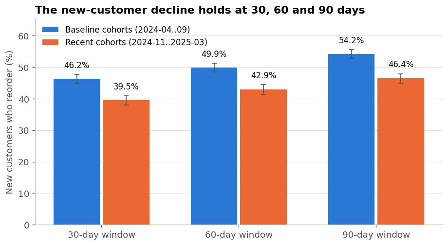
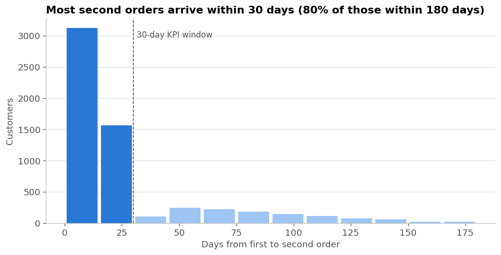

# Repeat-Purchase Decline: Attribution & Intervention Plan

**Period:** 2024-01-01 → 2025-06-30 (snapshot 2025-06-30)
**Data:** `orders_data.csv`: 42,776 raw order rows, treated as a 10% customer sample
**Report date:** 2025-07 (English edition and Phase 5–6 additions: 2026-10)

---

## 0. Data Provenance

> No production database access was available for this exercise, so the order log is simulated by `src/00_make_dataset.py` from an explicit generative model. The ground truth (ticket cliff, coupon dependency, category repeat gradients, service degradation from 2024-10) is hard-coded in the generator, but **no downstream script in Phases 1–6 reads those parameters**. Everything is rediscovered from the CSV. All absolute dollar figures extrapolate from the assumption that the extract is a 10% user sample; rates are unaffected. Treat this as a methodology demonstration, not a budget document.

---

## 1. Executive Summary

### The Core Problem

> The KPI we have been watching is the wrong one. Headline 30-day repeat fell only 58.2% → 56.3% (-2.0pp), which reads as noise, so nobody escalated. That number is flattered by **order-composition drift**: 41.7% of 2025 orders come from users with 4+ prior orders (vs 0% in 2024-01), and those users repeat at ~70%, propping up the average.
>
> Measured in a way composition cannot fake, the picture inverts: **new-user 30-day repeat fell 46.2% → 38.7%, -7.5pp, -16.3% relative (p = 2.6e-11)**. Cohort M+1 retention fell 34.7% → 27.2%, -21.8% relative. This is not noise. We are steadily losing every cohort we acquire, and the dashboard cannot see it.

| Metric | 2024 Q2–Q3 | 2025 Q1–Q2 | Δ | Relative | p |
|---|---|---|---|---|---|
| Headline repeat (all orders) | 58.2% | 56.3% | **-2.0pp** | -3.4% | 1.2e-03 ¹ |
| **New-user repeat** | **46.2%** | **38.7%** | **-7.5pp** | **-16.3%** | **2.6e-11** |
| New high-value users | 42.0% | 35.1% | -6.9pp | -16.4% | 4.0e-04 |
| Established users (3+ prior orders) | 71.9% | 69.1% | -2.8pp | -3.9% | 1.9e-03 ¹ |
| Cohort M+1 retention | 34.7% | 27.2% | -7.6pp | -21.8% | — |

¹ Order-level chi-square tests treat orders as independent. Re-tested with user-clustered standard errors in Phase 5, the headline p-value is 5.5e-03 (still significant). New-user tests are unaffected (one row per user).

### Three Key Findings

> **① Support contacts hit a cliff at the 3rd ticket, and ticket volume has doubled.** Repeat by ticket count: 0 → 59.2%, 1 → 48.3%, 2 → 40.9%, **3 → 22.6%**. The third ticket alone costs -18.4pp, more than either of the first two (-10.8pp, -7.4pp). A split-point scan confirms the steepest break at `cs_tickets >= 3` (-37.5pp, p = 7.1e-34). With full controls, 3+ tickets carries **OR = 0.220 [0.161, 0.302]**, a 78% reduction in the odds of repeat. Meanwhile the share of orders carrying any ticket rose from ~14% in early 2024 to 26.9% by 2025-06, and monthly ticket load correlates with new-user repeat at **r = -0.868**.
>
> **② The damage concentrates in Electronics and Home, our highest-AOV categories.** Electronics average tickets went 0.24 → 0.69 (nearly 3x), Home 0.25 → 0.42. These two are 27.9% of orders at $176.44 AOV, and have the two worst repeat rates (35.8%, 48.1%). The ticket gradient holds *inside every category*, so this is not "electronics buyers just don't repeat". We got worse at serving expensive baskets, which are exactly the ones worth most.
>
> **③ Coupon dependency erodes organic repeat, and we are leaning into it.** Among users with 3+ prior orders, those with ≤40% coupon history repeat at 72.9%; those at ≥80% repeat at 57.8% (-15.1pp, p = 3.8e-09). Model marginal effect: each +1.0 of dependency costs 14.9pp of repeat. Yet promo intensity is climbing: coupon share went from a ~33% 2024 average to ~48% in H1 2025, peaking at 59.2% in 2024-12. We are buying worse repeat with more discount.

### Recommended Actions & Expected ROI

> All three initiatives clear the break-even gate. Combined annualised incremental GMV **$852,230**, net contribution **$240,321**, net ROI **0.74x** (i.e. \$1.74 back per \$1 in). That is ~3.2% incremental on a $26.8M GMV base; retention programmes claiming much more than this are usually double-counting.

| # | Initiative | Addressable / yr | Effective uplift | Net contribution | ROI | Break-even gate |
|---|---|---|---|---|---|---|
| 2 | **Electronics/Home post-purchase fix** | 85,240 | +1.57pp | **$171,505** | 1.00x | ✅ needs 0.42pp |
| 1A | Automated service recovery (2 tickets) | 12,920 | +1.84pp | $29,878 | 0.85x | ✅ needs 0.03pp |
| 1B | Human callback (3+ tickets) | 4,160 | +8.39pp | $20,485 | 0.36x | ✅ needs 4.98pp |
| 3 | Coupon-dependency weaning | 26,760 | +1.87pp | $18,453 | 0.31x | ⚠️ needs 1.05pp; experiment first |
| | **Total** | | | **$240,321** | **0.74x** | |

These figures are planning estimates built on model counterfactuals, assumed costs and a 10% sample assumption. None of the uplifts has been measured in an experiment; §5 and §6 specify how each should be tested.

---

## 2. Phase 1: Data Diagnostic & Feature Engineering

### 2.1 Cleaning Log

> 42,776 raw rows in, 41,783 kept (97.68%). Principle: repair what is recoverable, quarantine what is not, and never drop a row without counting it. Full log at `logs/01_cleaning_log.txt`.

| # | Issue | Count | Action |
|---|---|---|---|
| 2.1 | Two date formats | 40,638 ISO + 2,138 US M/D/Y | Parsed separately and merged; 0 unparseable |
| 2.2 | Future-dated orders | 128 (max 2026-08-01) | Dropped (app-server clock skew) |
| 2.3 | Internal QA accounts | 120 | Dropped |
| 2.4 | Duplicate `order_id` | 745 (1.75%) | Kept first occurrence |
| 2.5 | Category casing/whitespace drift | 30 variants → 7 | Normalised; 503 blanks kept as `Unknown` |
| 2.6 | `discount_used` mixed types | Y/N and 1/0 | Coerced to 0/1 |
| 2.7 | `cs_tickets = -1` sentinel | 378 | Set to 0 and flagged; mode is 0 (80.4%), so this biases the ticket effect **downward** |
| 2.8a | Negative amounts | 165 | Absolute value taken and flagged (refunds written back with the wrong sign; the order is real) |
| 2.8b | Zero amounts | 126 | Kept (genuine engagement) and flagged `is_comped`; counted as orders in AOV ² |
| 2.8c | Missing amounts | 1,044 (2.50%) | Imputed with category median (amount is strongly category-driven; a global median would distort Electronics by ~4x) |
| 2.8d | Outliers > p99.9 ($938) | 42 | Winsorised, not dropped |

² The original log said comped orders were "excluded from AOV statistics", but no code excluded them. The wording was corrected to match the code; the effect on AOV is ~0.3%, and no published number changed.

> One judgement call worth surfacing: `cs_tickets = -1` is the legacy CRM's "unknown" sentinel. I set it to 0 rather than dropping the rows, because 0 is the modal value (80.4%). This **understates** the ticket effect rather than inflating it. In an analysis whose headline rests on that effect, the bias should run against my own conclusion. Phase 5 confirms the ticket gradient is unchanged when these rows are excluded.

### 2.2 Censoring

> 1,831 orders (4.4%) fall inside the trailing 30-day window and cannot yet be scored; all are excluded from repeat-rate and model calculations. **Skipping this manufactures a fake decline in the most recent months**, the single most common bug in repeat-rate reporting.

### 2.3 Engineered Features

> 13,959 users × 22 features; 39,952 scoreable orders in the modelling table. Running features (`cum_discount_rate`, `cum_return_rate`, `cum_orders`, `cum_gmv`, `avg_gap_to_date`) are **expanding windows over the user's own order history**, so no future orders leak in.
>
> **Timing caveat (added in review):** `cs_tickets` and `is_returned` describe the current order and are realised *after* purchase, so they can overlap the 30-day outcome window. In this analysis they are treated as concurrent service exposures for attribution, not as information available at checkout. With real data, ticket and return timestamps should be checked against the next-order date (see §7).

**User feature summary**

| Feature | mean | p50 | p90 | p99 | max |
|---|---|---|---|---|---|
| frequency | 2.99 | 2.00 | 7.0 | 20.00 | 39 |
| monetary | $261.76 | $142.91 | $624.0 | $1,682.83 | $6,777.80 |
| aov | $97.93 | $68.98 | $200.4 | $487.94 | $938.09 |
| recency_days | 235.70 | 223 | 454 | 533 | 545 |
| avg_gap_days | 27.04 | 18.00 | 58.0 | 132.00 | 247.5 |
| total_tickets | 0.69 | 0 | 2.0 | 6.00 | 16 |
| return_rate | 0.13 | 0 | 0.5 | 1.00 | 1.00 |
| discount_rate | 0.47 | 0.50 | 1.0 | 1.00 | 1.00 |

**RFM segments**

| Segment | Users | % of base | Avg frequency | Avg monetary | Avg recency (days) |
|---|---|---|---|---|---|
| Champions | 2,099 | 15.0% | 8.12 | $678.71 | 78 |
| Loyal | 3,255 | 23.3% | 3.01 | $230.78 | 154 |
| Hibernating | 3,049 | 21.8% | 1.18 | $76.84 | 401 |
| New / Promising | 1,846 | 13.2% | 1.00 | $109.80 | 92 |
| **At Risk (high value)** | **1,785** | **12.8%** | **4.09** | **$367.08** | **375** |
| Needs Attention | 1,176 | 8.4% | 1.00 | $108.30 | 224 |
| Can't Lose Them | 749 | 5.4% | 1.36 | $345.13 | 402 |

> `At Risk (high value)` holds 1,785 users averaging $367 lifetime spend who have not returned in ~375 days. That is the most expensive block of churn on the board, and 17.9% of all GMV to date (Phase 5).

---

## 3. Phase 2: EDA & Cohort Analysis

### 3.1 Three Metric Definitions

> The methodological core of this phase: **the metric definition is itself the finding.** Three definitions are used (formal definitions in [`docs/kpi_definitions.md`](docs/kpi_definitions.md)):
>
> - `headline_repeat`: all scoreable orders. What the business reports. Composition-weighted and therefore **misleading**.
> - `new_user_repeat`: share of a month's new users ordering again within 30 days. No survivorship, no composition effect.
> - `established_repeat`: orders from users with 3+ prior orders. Fixed lifecycle position, so calendar movement is real.


| Month | Headline | **New-user** | Established | Avg tickets | Coupon share |
|---|---|---|---|---|---|
| 2024-06 | 58.0% | 45.1% | 73.6% | 0.178 | 40.1% |
| 2024-09 | 58.2% | 43.9% | 73.1% | 0.164 | 37.2% |
| 2024-10 | 59.4% | 47.4% | 71.7% | 0.185 | 40.7% |
| 2024-11 | 55.2% | 41.5% | 71.4% | 0.220 | 53.8% |
| 2024-12 | 55.0% | 39.3% | 71.4% | 0.246 | 59.2% |
| 2025-01 | 56.7% | 37.3% | 68.6% | 0.295 | 45.4% |
| 2025-03 | 55.3% | 38.1% | 67.5% | 0.334 | 47.0% |
| 2025-05 | 56.8% | 39.1% | 67.9% | 0.324 | 50.5% |

**Order composition drift**

| Month | Share of orders from users with 4+ prior orders | Share of orders from new users |
|---|---|---|
| 2024-01 | 0.0% | 77.2% |
| 2024-06 | 22.7% | 34.6% |
| 2024-12 | 32.4% | 31.5% |
| 2025-05 | **41.7%** | 26.6% |

> This table explains everything. Orders from deep-lifecycle users went from 0% to 41.7% of the mix, and those users repeat at ~70%. So even as every individual group deteriorates, the weighted headline barely moves. **The metric isn't broken; we were reading the wrong one.**

### 3.2 Cohort Retention Matrix


**M+1 retention by cohort**

| Cohort | M+1 | | Cohort | M+1 |
|---|---|---|---|---|
| 2024-01 | 34.8% | | 2024-10 | 32.6% |
| 2024-02 | 38.5% | | **2024-11** | **28.2%** |
| 2024-03 | 34.5% | | **2024-12** | **25.7%** |
| 2024-04 | 36.7% | | 2025-01 | 26.9% |
| 2024-05 | 33.5% | | 2025-02 | 27.8% |
| 2024-06 | 33.7% | | 2025-03 | 25.3% |
| 2024-07 | 35.2% | | 2025-04 | 26.3% |
| 2024-08 | 33.7% | | 2025-05 | 30.1% |
| 2024-09 | 32.0% | | | |

> 2024-01..09 averages 34.7%; 2024-11..2025-05 averages 27.2%: **a 7.6pp drop, -21.8% relative**. The break lands precisely at 2024-11, coinciding with the rise in ticket load. Every cohort acquired from 2024-11 onward retains worse from M+1 onward. (Averages are unweighted means of cohort rates.)

> **⚠️ Methodology correction:** My first pass ran a "mature cohort calendar trend" test (2024 H1 cohorts only, tracked into 2025) which showed repeat *rising* 59.1% → 74.5%. That was **survivorship bias**: the only 2024-cohort users still ordering in 2025 are the hardcore repeaters by construction. The test was discarded and its intermediate output deleted. The M+1 view above is immune to this.

### 3.3 High vs Low Repeater Profiling

| Feature | High repeater (4+) | One-and-done | Difference | Cohen's d | p |
|---|---|---|---|---|---|
| n_categories | 2.851 | 1.000 | +1.851 | 2.652 | ~0 |
| monetary | $625.80 | $110.60 | +$515.20 | 1.655 | ~0 |
| **total_tickets** | **1.563** | **0.301** | **+1.261** | **1.025** | **7.4e-246** |
| **max_tickets** | **0.851** | **0.301** | **+0.549** | **0.799** | **5.7e-229** |
| recency_days | 173.7 | 263.0 | -89.3 | -0.610 | 6.8e-182 |
| **discount_rate** | **0.401** | **0.532** | **-0.131** | **-0.306** | **3.6e-69** |
| aov | $82.73 | $110.60 | -$27.85 | -0.274 | 7.6e-58 |
| return_rate | 0.110 | 0.137 | -0.027 | -0.094 | 2.5e-08 |

> **⚠️** The huge gaps on `n_categories` and `monetary` are **mechanical**: more orders trivially means more categories and more spend. Both are descriptive only and are excluded from the causal read in Phase 3. Likewise `total_tickets` is partly inflated by order count, which is why `max_tickets` (peak intensity) and the order-level analysis below carry the actual weight.

**Channel mix** (χ² = 478.5, p = 2.9e-98)

| Channel | High repeater 4+ | Low repeater 2–3 | One-and-done |
|---|---|---|---|
| Organic | **34.9%** | 23.9% | 19.9% |
| Paid Search | 26.6% | 26.0% | 24.8% |
| Email/CRM | 16.1% | 14.3% | 12.8% |
| Paid Social | 15.8% | 24.7% | **27.5%** |
| Affiliate | 6.6% | 11.1% | **15.0%** |

**Category mix** (χ² = 1007.8, p = 3.9e-208)

| Category | High repeater 4+ | One-and-done |
|---|---|---|
| Beauty | **25.4%** | 15.1% |
| Apparel | 24.2% | 21.8% |
| Grocery | **21.6%** | 10.9% |
| Home | 14.0% | 19.2% |
| Electronics | 8.3% | **23.3%** |

### 3.4 Tipping Points


**① Support contacts**

| cs_tickets | Orders | 30-day repeat | Change vs previous | AOV |
|---|---|---|---|---|
| 0 | 32,634 | 59.2% | — | $82.24 |
| 1 | 6,006 | 48.3% | **-10.8pp** | $104.20 |
| 2 | 1,051 | 40.9% | -7.4pp | $136.18 |
| **3** | **204** | **22.6%** | **-18.4pp** | $151.66 |
| 4 | 39 | 10.3% | -12.3pp | $124.38 |

**Split-point scan**

| k | Repeat if < k | Repeat if ≥ k | Δ | χ² | p |
|---|---|---|---|---|---|
| 1 | 59.2% (n=32,634) | 46.2% (n=7,318) | -12.9pp | 407 | 1.4e-90 |
| 2 | 57.5% (n=38,640) | 36.7% (n=1,312) | -20.8pp | 224 | 1.5e-50 |
| **3** | **57.1% (n=39,691)** | **19.5% (n=261)** | **-37.5pp** | **147** | **7.1e-34** |

> Steepest break at `cs_tickets >= 3`. Note AOV rises with ticket count ($82 → $152): **expensive orders are the ones that go wrong**, which makes the economic cost of tickets far larger than their order share suggests.

**Category × ticket cross-check** (cells with n < 30 suppressed)

| Category | 0 | 1 | 2 | 3+ |
|---|---|---|---|---|
| Grocery | 70.7% | 60.2% | 58.6% | — |
| Beauty | 66.7% | 61.2% | 45.2% | — |
| Apparel | 57.8% | 52.3% | 47.7% | 26.1% |
| Sports | 55.4% | 48.7% | 43.4% | — |
| Home | 50.2% | 43.0% | 43.0% | 19.4% |
| Electronics | 38.5% | 31.2% | 28.6% | 12.9% |

> The gradient holds *within every category*, ruling out category confounding. Five cells with n < 30 are suppressed (e.g. Grocery/3+ has n=2 and showed 100% repeat in raw output, which is pure noise).

**② Coupon dependency**

> **⚠️** A trap worth documenting. Banding raw `cum_discount_rate` yields an alarming "80–100% band repeats at only 34.4%", but that band's average prior-order count is **0.43**. A user with one coupon-using order mechanically has dependency = 1.0. That band is just one-and-done users, not dependent users.

**De-confounded (users with 3+ prior orders only)**

| Coupon dependency | Orders | 30-day repeat | Avg prior orders |
|---|---|---|---|
| 0–20% | 4,071 | 72.8% | 6.19 |
| 20–40% | 5,368 | 73.0% | 8.20 |
| 40–60% | 3,575 | 68.1% | 7.33 |
| 60–80% | 1,378 | 64.2% | 6.31 |
| 80–100% | 259 | 56.8% | 4.98 |

> After de-confounding, **the first two bands are effectively tied (72.8% vs 73.0%, within noise); the monotonic decline starts above 40%**, reaching a cumulative -16pp by the 80–100% band. Pooled test: ≤40% dependency repeats at 72.9% (n=9,439) vs 57.8% (n=431) at ≥80%: **15.1pp, p = 3.8e-09**. Prior-order counts are comparable across bands (5–8), ruling out the mechanical "few orders → high dependency" effect.
>
> Note: the pooled ≥80% group (n=431) and the banded 80–100% row (n=259) differ in size because the former includes orders at exactly 0.80 while the band is (0.80, 1.00]. Both point the same way.

**③ Root cause: ticket load doubled**


| Month | Avg tickets | % orders with ≥1 ticket | % orders with ≥3 tickets | Return rate |
|---|---|---|---|---|
| 2024-01 | 0.154 | 13.9% | 0.20% | 10.5% |
| 2024-09 | 0.164 | 14.1% | 0.29% | 10.1% |
| **2024-11** | **0.220** | **18.6%** | 0.54% | 11.4% |
| 2025-01 | 0.295 | 22.9% | 1.16% | 12.5% |
| 2025-03 | 0.334 | 25.0% | 1.52% | 12.8% |
| **2025-06** | **0.345** | **26.9%** | 1.37% | 13.4% |

**Ticket escalation by category**

| Category | 2024-01 | 2025-06 | Multiple |
|---|---|---|---|
| **Electronics** | 0.237 | **0.691** | **2.9x** |
| Apparel | 0.107 | 0.432 | 4.0x |
| Beauty | 0.089 | 0.185 | 2.1x |
| **Home** | 0.250 | **0.417** | 1.7x |
| Grocery | 0.081 | 0.169 | 2.1x |

> Monthly correlations: % orders with ≥1 ticket vs new-user repeat **r = -0.868**; vs established repeat r = -0.449. With n = 17 months this is directional support, not proof. Phase 3 tests it formally at the order level with controls.

---

## 4. Phase 3: Modeling & Hypothesis Testing

### 4.1 Setup

> 39,952 scoreable orders, 13,513 users, 2.96 orders/user.
>
> - **Standard errors clustered on `user_id`.** A user contributes many orders; without clustering every p-value would be spuriously significant. Not optional.
> - **Strict temporal split.** Train 2024-01..2025-01 (30,779), holdout 2025-02..2025-05 (9,173). A random split would leak: the same user's later orders would sit in train while earlier ones sit in test.

### 4.2 Mediation Ladder

| Model | `degraded` coefficient | OR | p | pseudo-R² |
|---|---|---|---|---|
| M0: period only | -0.0397 | 0.961 | 0.095 | 0.0001 |
| **M1: + composition controls** | **-0.2673** | **0.765** | **1.2e-33** | 0.0873 |
| M2: + service variables | -0.2320 | 0.793 | 3.0e-25 | 0.0919 |
| M3: + coupon dependency | -0.1357 | 0.873 | 4.0e-09 | 0.1030 |

> This ladder is the methodological crux of the analysis, and reads in two steps:
>
> **Step 1, confounding.** Measured alone, the period effect is OR = 0.961, p = 0.095, so **apparently nothing happened**. Once lifecycle depth and category/channel mix are controlled, the same variable becomes OR = 0.765, p = 1.2e-33. The damage was never absent; composition drift masked it, which corroborates the Phase 2 cohort view.
>
> **Step 2, mediation.** Adding tickets and returns moves the period penalty from OR 0.765 to 0.793: **service variables alone absorb 13.2%** of the period effect. Adding coupon dependency takes it to OR 0.873: **service + dependency together account for 49.2%**. The remaining 50.8% is what the order log cannot see: delivery speed, stockouts, assortment. That residual is itself the argument for instrumenting those systems.
>
> **⚠️ Correction logged:** My first ladder introduced composition controls *alongside* the mediators, producing an insignificant M1 coefficient that flipped sign in M2 and a meaningless "392% mediated". Confounders must sit in the baseline, or you are measuring confounding cleanup rather than mediation. Rebuilt.
>
> "Mediation" here is a descriptive decomposition of a regression coefficient (log-odds scale), not a formal causal mediation analysis.

### 4.3 Odds Ratios (M3, cluster-robust)


| Variable | OR | 95% CI | Change in odds | p |
|---|---|---|---|---|
| **3+ support tickets** | **0.220** | [0.161, 0.302] | **-78.0%** | 6.9e-21 |
| **Coupon dependency (+1.0)** | **0.495** | [0.452, 0.542] | **-50.5%** | 2.6e-51 |
| Electronics (vs Apparel) | 0.557 | [0.509, 0.609] | -44.3% | ~0 |
| 2 support tickets | 0.617 | [0.539, 0.707] | -38.3% | 3.0e-12 |
| 1 support ticket | 0.740 | [0.696, 0.785] | -26.0% | 6.7e-23 |
| Affiliate (vs Paid Search) | 0.740 | [0.677, 0.810] | -26.0% | ~0 |
| Home (vs Apparel) | 0.767 | [0.714, 0.824] | -23.3% | ~0 |
| Paid Social (vs Paid Search) | 0.792 | [0.741, 0.847] | -20.8% | ~0 |
| Order returned | 0.826 | [0.772, 0.883] | -17.4% | 2.4e-08 |
| Degraded period (from 2024-10) | 0.873 | [0.835, 0.913] | -12.7% | 4.0e-09 |
| Order value (+1 SD) | 0.877 | [0.850, 0.906] | -12.3% | ~0 |
| Coupon on this order | 0.964 | [0.900, 1.031] | -3.6% | 0.283 |
| Beauty (vs Apparel) | 1.248 | [1.166, 1.336] | +24.8% | ~0 |
| Organic (vs Paid Search) | 1.354 | [1.276, 1.436] | +35.4% | ~0 |
| Grocery (vs Apparel) | 1.446 | [1.342, 1.559] | +44.6% | ~0 |
| **Lifecycle depth (log orders)** | **1.776** | [1.696, 1.859] | **+77.6%** | ~0 |

> Note `discount_used` (coupon on this order) is OR = 0.964, **p = 0.283, not significant**, while `disc_dep_c` (accumulated dependency) is OR = 0.495 and highly significant. The contrast matters: **issuing a coupon does no measurable harm; training a user to buy only on coupon does.** This directly shapes Initiative 3: the goal is not to stop couponing but to break the dependency loop.

**Average marginal effects (pp)**

| Variable | dy/dx (pp) | 95% CI | p |
|---|---|---|---|
| 3+ support tickets | **-32.14** | [-38.83, -25.45] | ~0 |
| Coupon dependency (+1.0) | **-14.94** | [-16.87, -13.02] | ~0 |
| Electronics | -12.44 | [-14.33, -10.54] | ~0 |
| 2 support tickets | -10.25 | [-13.12, -7.38] | ~0 |
| 1 support ticket | -6.41 | [-7.68, -5.14] | ~0 |
| Order returned | -4.08 | [-5.50, -2.65] | ~0 |
| Degraded period | -2.88 | [-3.84, -1.93] | ~0 |
| Lifecycle depth | +12.20 | [11.26, 13.14] | ~0 |

### 4.4 Gradient Boosting & Feature Importance


> Holdout AUC **0.7206** (train 0.7285, overfitting gap only +0.0079). Average precision 0.7511, a 1.34x lift over the 56.1% base rate.

| Feature | AUC drop when shuffled | Share |
|---|---|---|
| cum_orders | 0.0535 | 36.7% |
| category | 0.0300 | 20.6% |
| cum_discount_rate | 0.0225 | 15.4% |
| channel | 0.0137 | 9.4% |
| cs_tickets | 0.0100 | 6.8% |
| order_amount | 0.0076 | 5.2% |

> **⚠️ Important:** `cs_tickets` carries only **6.8%** of permutation importance, far below what its odds ratio suggests. Not a contradiction: **only 18.3% of orders have any ticket**, so the variable is near-constant for most rows and shuffling it barely moves global AUC. The ticket lever is **deep but narrow**: a large effect on a small population. Phase 4 must size it on the *affected* population or it will be badly overstated.
>
> Conversely `cum_discount_rate` carries 15.4% and applies to every order: **shallow but wide**. That is the bigger pot of money. This deep-narrow vs shallow-wide distinction directly drives the scale differences among the three initiatives.

### 4.5 Ticket Counterfactual


| cs_tickets | Model-predicted repeat | vs 0 | Marginal | Training support |
|---|---|---|---|---|
| 0 | 60.6% | — | — | 25,708 |
| 1 | 55.7% | -4.8pp | -4.8pp | 4,286 |
| 2 | 52.1% | -8.5pp | -3.7pp | 654 |
| 3 | 39.0% | **-21.6pp** | **-13.1pp** | 109 |
| 4 | 39.0% | -21.6pp | 0.0pp | 15 |

> This is what Phase 4 sizes against. Because it holds the other features fixed, it nets out part of the selection effect (people who complain may be leaving anyway) and is far more conservative than the raw observational gap (-37.5pp). It is still a model estimate, not an experimental one.
>
> **⚠️ Note k=4 is identical to k=3** because the training set holds only 109 orders at 3 tickets and 15 at 4; the tree has no split there and saturates. **Read the curve to k=3 only**; beyond that it is extrapolation, not evidence.

**If tickets went to zero, by category (holdout)**

| Category | Orders | Actual repeat | Predicted as-is | Predicted with zero tickets | Uplift |
|---|---|---|---|---|---|
| **Electronics** | 1,045 | 33.3% | 37.4% | 40.2% | **+2.79pp** |
| **Home** | 1,431 | 46.0% | 50.5% | 53.0% | **+2.49pp** |
| Sports | 705 | 53.9% | 52.8% | 54.7% | +1.90pp |
| Apparel | 1,951 | 55.5% | 58.4% | 59.9% | +1.49pp |
| Beauty | 2,153 | 64.5% | 67.5% | 68.6% | +1.04pp |
| Grocery | 1,784 | 69.5% | 71.4% | 72.1% | +0.76pp |

### 4.6 Two-Model Cross-Check

> The logit and the GBM make entirely different assumptions yet land on the same top levers (lifecycle depth, category, coupon dependency, support contacts). Short of an experiment, that convergence is the strongest evidence available here. It is still observational evidence: unobserved confounders could affect both models the same way.

---

## 5. Phase 4: Financial & ROI Impact

### 5.1 Sizing Discipline

> Five rules, stated up front so they can be challenged:
>
> 1. **Addressable population is an actual count** from 2025Q1 (last complete quarter clear of censoring), annualised ×4, grossed up ×10 for the sample. No "assume we reach X% of the base".
> 2. **Value per incremental repeat uses the addressed rows' own AOV**, not the blend. Electronics averages $253 vs Grocery $32; one blended figure would misprice targeted work by ~3x.
> 3. **Effect size comes from the Phase 3 model counterfactual**, then takes a realisation haircut < 1.
> 4. **Cost-to-serve savings are reported separately** from revenue effects.
> 5. **Every initiative faces a break-even gate.** Failures are labelled FAIL and explained, not buried.

**Baseline**

| Item | Value |
|---|---|
| 2025Q1 scoreable orders (in extract) | 7,631 |
| Sample gross-up factor | ×10 |
| Annualised GMV | $26,758,823 |
| Annualised contribution (42% margin) | $11,238,705 |
| Blended AOV | $87.66 |

**Downstream multiplier**

> The LTV multiplier is derived from the observed continuation chain, not assumed:

| cum_orders | Continuation rate |
|---|---|
| 0 | 43.9% |
| 1 | 51.8% |
| 2 | 58.5% |
| 3 | 62.6% |
| 4 | 67.7% |
| 7 | 72.3% |

> One incremental repeat is worth **2.37 orders** in expectation (itself + 1.37 follow-ons, chain capped at 8 steps). Observed rather than fitted, and capped, so deliberately conservative.

| Segment | AOV | Contribution value per repeat |
|---|---|---|
| Blended | $87.66 | $87.17 |
| **Electronics** | **$253.15** | **$251.73** |
| Home | $105.75 | $105.16 |
| Grocery | $32.17 | $31.99 |

(Blended AOV is 2025Q1; category AOVs are full-period and illustrative. Each business case below uses the AOV of its own addressed orders.)

### 5.2 Initiative 1: Tiered Service Recovery

> The 2025Q1 extract holds 323 orders at exactly 2 tickets and 104 at 3+, grossing to 12,920 and 4,160 cases/yr. Their AOVs are $128.44 and $145.43, **both well above the $87.66 blend**. Complaints concentrate in expensive baskets, which is precisely what makes this worth doing.
>
> **Cost design decides whether this lives.** A human callback is fully loaded at ~$9–14/case. Tier A's modelled +3.7pp cannot cover that; Tier B's +16.8pp can. **The tiering is not a presentation choice. It falls out of the break-even arithmetic.**

| Tier | Action | Cases / yr | Unit cost | Fixed cost | Effective uplift | Net contribution | ROI |
|---|---|---|---|---|---|---|---|
| **A** | Automated apology + priority re-routing + service credit | 12,920 | $0.80 | $25k | +1.84pp | **$29,878** | 0.85x |
| **B** | Senior-agent callback | 4,160 | $9.00 | $20k | +8.39pp | **$20,485** | 0.36x |

### 5.3 Initiative 2: Electronics / Home Post-Purchase Fix

> This is **the big one**. Electronics + Home are 27.9% of orders at $176.44 AOV with the two worst repeat rates. Model counterfactual: zeroing tickets in these categories is worth **+2.62pp** (order-weighted), the ceiling for any contact-only fix.
>
> Root cause located in Phase 2: Electronics avg tickets 0.24 → 0.69, Home 0.25 → 0.42. **This is a fulfilment and product-information problem, not a contact-centre capacity problem.** Current cost-to-serve is 0.510 tickets/order × $6 = $3.06/order; a 30% reduction is assumed.

| Item | Value |
|---|---|
| Addressable / yr | 85,240 orders |
| Unit cost | $0.25 (proactive delivery comms + product-page spec fixes, amortised) |
| Fixed cost | $150,000 (content rebuild + inbound QC sampling) |
| Additional saving | $0.35/order (reverse logistics) |
| Effective uplift | +1.57pp |
| Incremental GMV | $559,023 |
| Repeat contribution | $234,789 |
| Cost-to-serve avoided | $108,026 |
| **Net contribution** | **$171,505** |
| **ROI** | **1.00x** |

### 5.4 Initiative 3: Coupon-Dependency Weaning

> **⚠️** The observational gap is 9.1pp, but I am **not planning on it**. Causality plausibly runs backwards: low-intent users seek out coupons. Of the three, this has the weakest causal identification. The planning number takes the Phase 3 marginal effect of 14.9pp × a realistic 0.25 dependency shift = **3.7pp**, less than half the observational gap.
>
> **This must ship as a randomised holdout test, not a rollout.** It is ranked third not because the population is small (it is the largest) but because the evidence is thinnest.

| Item | Value |
|---|---|
| Addressable / yr | 26,760 orders (users with 3+ orders and ≥60% coupon dependency) |
| Unit cost | $0.90 CRM, offset by $1.31/order recovered margin |
| Fixed cost | $35,000 |
| Effective uplift | +1.87pp |
| **Net contribution** | **$18,453** |
| **ROI** | **0.31x** |

### 5.5 Consolidated Business Case


| Initiative | Addressable / yr | Effective uplift | Incremental GMV | Repeat contribution | Cost avoided | Programme cost | Net contribution | ROI | Gate |
|---|---|---|---|---|---|---|---|---|---|
| 1A Automated recovery | 12,920 | +1.84pp | $72,214 | $30,330 | $34,884 | $35,336 | $29,878 | 0.85x | ✅ needs 0.03pp |
| 1B Human callback | 4,160 | +8.39pp | $120,165 | $50,469 | $27,456 | $57,440 | $20,485 | 0.36x | ✅ needs 4.98pp |
| **2 Electronics/Home fix** | 85,240 | +1.57pp | $559,023 | $234,789 | $108,026 | $171,310 | **$171,505** | 1.00x | ✅ needs 0.42pp |
| 3 Coupon weaning | 26,760 | +1.87pp | $100,828 | $42,348 | $35,189 | $59,084 | $18,453 | 0.31x | ✅ needs 1.05pp |
| **Total** | | | **$852,230** | **$357,936** | **$205,555** | **$323,170** | **$240,321** | **0.74x** | |

| Scenario | Net contribution |
|---|---|
| Conservative | $120,879 |
| **Base** | **$240,321** |
| Optimistic | $359,764 |

> Incremental GMV is **3.2%** of the $26.8M run-rate; net contribution is **2.1%** of annual contribution. Retention programmes claiming much more than this are usually double-counting.

### 5.6 Sensitivity


**Net contribution ($) by uplift multiplier × LTV multiplier**

| Uplift multiplier \ LTV | 1.00 | 2.37 | 3.08 |
|---|---|---|---|
| 0.25 | -79,827 | -28,149 | -1,309 |
| 0.50 | -42,040 | **61,317** | 114,996 |
| 0.75 | -4,252 | **150,782** | 231,302 |
| **1.00** | 33,535 | **240,248** | 347,607 |
| 1.25 | 71,323 | 329,714 | 463,913 |
| 1.50 | 109,111 | 419,180 | 580,218 |

> **13 of 18** scenarios are value-positive; range -$79,827 to $580,218.
>
> **Two honest disclosures:**
> 1. **At half the modelled uplift AND an LTV multiplier of 1.0** (incremental repeats generate no follow-on orders) **the portfolio turns negative (-$42,040).** The case does depend on the premise that a rescued repeat leads to further repeats. The observed continuation curve supports it, but it is a premise.
> 2. **Floor test: if repeat uplift were exactly zero and only cost-to-serve savings landed, the portfolio nets -$117,615.** There is no free floor; some repeat uplift must materialise.

### 5.7 What Recovery Means

> M+1 retention fell 7.6pp. Against the 57,860 users acquired since 2024-11, roughly **4,374 users** would have returned under the old service level and did not. The recommended portfolio delivers **2,424 incremental repeat orders/yr**. This is a **partial recovery, by design**: Phase 3 showed ~51% of the controlled decline sits in systems the order log cannot observe (delivery speed, stockouts, assortment). Closing the rest requires instrumentation we do not currently have.
>
> (Corrected in review: the original figure of 4,339 used hand-typed retention values of 34.7% and 27.2%; `04_roi.py` now reads the exact cohort means, 34.75% and 27.19%, from the Phase 2 table.)

---

## 6. Phase 5–6: KPI Validation & Robustness (added in review)

These two phases were added to answer the questions a reviewer would ask next. Scripts: `src/05_kpis_robustness.py`, `src/06_sql_checks.py`; logs: `logs/05_kpi_log.txt`, `logs/06_sql_checks_log.txt`.

### 6.1 Single KPI definitions

All KPIs are implemented once in [`src/kpis.py`](src/kpis.py) and used by the analysis, the dashboard and the tests. Each has an explicit numerator, denominator, window and counting unit (`outputs/tables/05_kpi_summary.csv`, explained in [`docs/kpi_definitions.md`](docs/kpi_definitions.md)).

| KPI (full period) | Value | Numerator / denominator |
|---|---|---|
| Orders / active customers | 41,783 / 13,959 | — |
| GMV | $3,653,883 | — |
| AOV | $87.45 | GMV / 41,783 orders |
| Order-level 30-day repeat | 56.8% | 22,697 / 39,952 scoreable orders |
| New-customer 30-day repeat | 43.9% | 5,935 / 13,513 observable new customers |
| 90-day repeat customer rate | 51.8% | 6,405 / 12,368 customers with ≥ 90 days of observation |
| Median days to 2nd order | 15 | customers with a 2nd order |

### 6.2 First-time vs repeat customers

| Customer type | Customers | Share of customers | Share of GMV | Avg orders | Avg AOV |
|---|---|---|---|---|---|
| One-time | 6,460 | 46.3% | 19.5% | 1.0 | $110.58 |
| Repeat (2+ orders) | 7,499 | 53.7% | **80.5%** | 4.7 | $87.03 |

> Repeat customers generate 80% of GMV through **frequency, not basket size**: their AOV is lower than one-time buyers'. The first-to-second order transition is the main value lever. ("Ever ordered twice" is tenure-biased, so this table is used for GMV attribution only, not for trends.)

### 6.3 Robustness checks



| Check | Result |
|---|---|
| **Repeat window.** New-customer repeat for the *same* customers (baseline cohorts Apr–Sep 2024, n=4,932; recent cohorts Nov 2024–Mar 2025, n=4,195) at 30 / 60 / 90 days | -6.8pp / -7.0pp / -7.8pp; all p < 1e-10. **The decline is not an artefact of the 30-day window.** |
| **Imputed tickets.** Ticket gradient excluding the 360 scoreable orders whose `cs_tickets` was imputed from the -1 sentinel | 59.2% / 48.3% / 40.9% / 19.5% for 0 / 1 / 2 / 3+ tickets, unchanged |
| **Clustered test for the headline.** Recent vs baseline headline repeat with user-clustered SEs | p = 5.5e-03 (naive: 1.1e-03); still significant, less strongly |
| **SQL cross-check.** Core KPIs re-implemented in SQLite with `LEAD()` / `ROW_NUMBER()` from raw columns only | **9/9 checks match** the pandas pipeline (tolerance 1e-9) |



> 80% of second orders placed within 180 days arrive within 30 days (median 15 days). **Caveat:** on this simulated data the break at day 30 is partly built into the generator, so this chart illustrates the method; it does not independently validate the 30-day window. With real data the window should be chosen from this distribution.

---

## 7. Implementation Roadmap

| Phase | Timing | Action | Owner | Success criterion |
|---|---|---|---|---|
| **P0** | Week 1–2 | Switch reporting: add `new_user_repeat` and cohort M+1 to the weekly business review; demote headline repeat to a secondary metric | Analytics | Leadership reviews the new metrics |
| **P0** | Week 1–2 | Real-time alert at `cs_tickets >= 2` | Data Eng | Alert latency < 24h |
| **P1** | Week 3–8 | Initiative 1A: automated recovery (12,920 cases/yr), with a randomised 10% holdout | CS Ops | Primary: fewer escalations to 3+ tickets and follow-up contacts vs holdout (repeat uplift is too small to detect quickly) |
| **P1** | Week 3–8 (test runs ~6–7 months) | Initiative 1B: human callback at 3+ tickets, as a 50/50 randomised test (volume too low for a 10% holdout) | CS Ops | Callback coverage > 80%; uplift ≥ 4.98pp break-even |
| **P2** | Month 2–5 | Initiative 2: Electronics/Home product-page spec fixes + proactive delivery comms + inbound QC; staged rollout by category or region | Merchandising / Fulfilment | Tickets per order in both categories back to ≤ 0.35 |
| **P3** | Month 3–6 | Initiative 3: coupon-dependency weaning as a **randomised controlled test** (no rollout) | CRM / Analytics | Scale only after a significant test readout |
| **P4** | Month 4+ | Instrument delivery time, stockouts and assortment changes | Data Eng | Explain the ~51% that Phase 3 leaves unexplained |

> The P0 metric switch costs nothing and ships in-week, and it gates everything else: **if we keep watching the headline rate, the next decline will be masked by composition drift exactly as this one was.**

**Experiment design notes.** Randomise at the customer level, not the order level. Pre-register 30-day repeat as the primary metric with margin per customer as a guardrail. Size the holdout from the base rate and the break-even uplift in §5.5. For example, Tier B must show ≥ 4.98pp to pay for itself. On a ~20% base rate, detecting that needs about 1,100 customers per arm (80% power, α = 0.05; computed with `statsmodels`). At 4,160 cases/yr, a 50/50 split takes roughly 6–7 months, while a 10% holdout would take years. **Tier B therefore needs a 50/50 test.** Tier A has the opposite problem: its modelled uplift (+1.84pp on a ~41% base) would need ~11,300 customers per arm, which is 1.7 years at 50/50 or ~9 years with a 10% holdout. But its break-even uplift is only 0.03pp, because avoided contacts nearly pay for it. So Tier A's test should use the **cost mechanism** as its primary metric (escalation to 3+ tickets, follow-up contacts per case), with 30-day repeat tracked as a secondary, directional metric. The coupon test (Initiative 3: +1.87pp on a ~64% base) needs ~10,200 per arm: about 9 months of addressable volume at 50/50. That volume is counted in orders, and randomisation is by customer, so in practice it will take longer. Plan it as the longest-running test.

---

## 8. Limitations & Next Steps

1. **Data is simulated** (see §0). The methodology transfers; the absolute dollar figures do not. Because the patterns were planted, finding them demonstrates the method works, not that these effects exist in any real business.
2. **No experimental evidence.** All inference is observational. The ticket and dependency effects survive controls and cross-model agreement, but unobserved confounding cannot be ruled out. Initiatives 1 and 3 are specified with holdouts for this reason.
3. **~51% of the decline is unexplained.** The order log lacks delivery time, stockouts, assortment changes and session behaviour. This is the largest known blind spot.
4. **Outcome-window overlap.** `cs_tickets` and `is_returned` are realised after purchase and may partly overlap the 30-day outcome window (and reverse causality is possible: customers already leaving may complain more). With real data, use only tickets/returns timestamped before the next order or before day 30.
5. **`is_returned` and `channel` are schema extensions.** The original schema had no return field, but Phase 1 called for a historical return-rate feature, so it was added at generation and flagged.
6. **The k≥4 ticket range is under-supported** (15 training orders); the model saturates there, so the curve is read only to k=3.
7. **The 10% sample rate is an assumption.** A different true rate scales every absolute figure proportionally; rates and ROI are unchanged. Unit costs and the 30% ticket-reduction assumption are planning inputs, not measurements.

---

## Appendix: File Manifest

> The `data/` files below are generated locally and **not tracked in the repo** (~19 MB, all deterministically rebuilt by the seeded generator). Run `python src/run_all.py` after cloning and they all appear.

```
data/raw/orders_data.csv              raw extract (42,776 rows)                [generated]
data/processed/orders_clean.csv       cleaned orders (41,783 rows)             [generated]
data/processed/user_features.csv      user features (13,959 x 22)              [generated]
data/processed/order_model_table.csv  model table (39,952 scoreable orders)    [generated]
data/processed/holdout_scored.csv     scored holdout                           [generated]

src/00_make_dataset.py                data generator (generative model, holds the ground truth)
src/common.py                         shared paths and constants
src/kpis.py                           single source of KPI definitions
src/01_clean_features.py              Phase 1
src/02_eda_cohort.py                  Phase 2
src/03_modeling.py                    Phase 3
src/04_roi.py                         Phase 4
src/05_kpis_robustness.py             Phase 5 (KPI table, customer comparisons, robustness)
src/06_sql_checks.py                  Phase 6 (SQL cross-check)
src/run_all.py                        runs every phase in order
sql/kpi_queries.sql                   SQL implementation of the core KPIs

logs/0*_log.txt                       full audit output of each phase
outputs/figures/                      12 charts
outputs/tables/                       34 result tables
dashboard/app.py                      Streamlit dashboard
presentation/                         executive deck (.pptx + .pdf) and its build script
```

**Reproduce:**
```bash
pip install -r requirements.txt
python src/run_all.py
```
